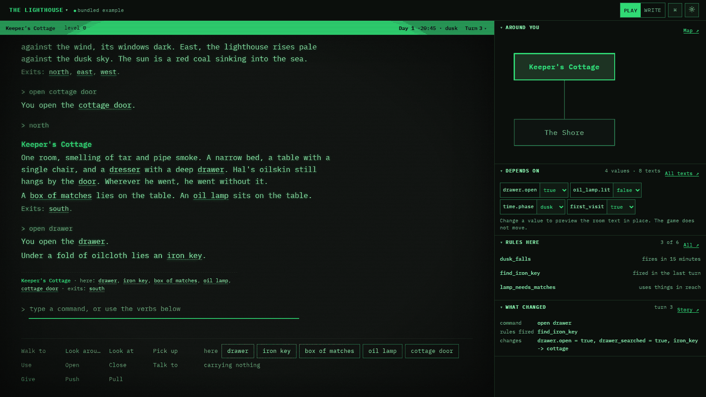
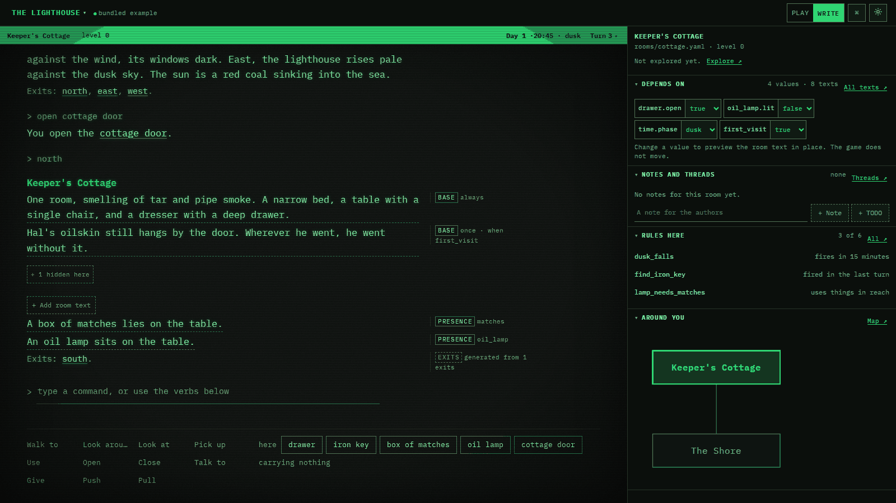
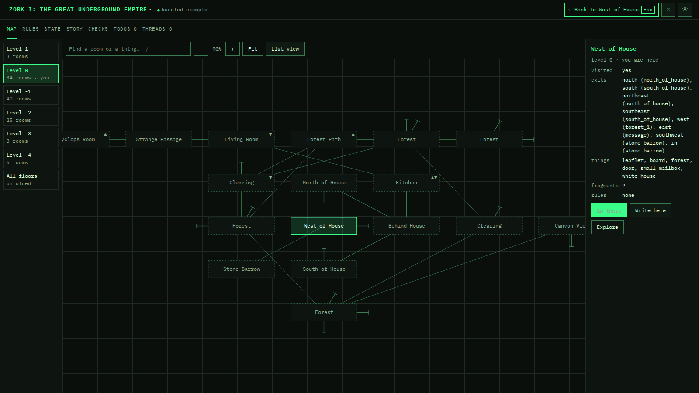

# loremaster

loremaster is a world editor for text adventures. In loremaster, each text in the game comes from the world state. The author can see which text shows, when it shows and why.

The core is in Rust. It uses [dramaturge](https://github.com/sunsided/dramaturge). The editor is a SvelteKit app. The player can play with typed commands or with a SCUMM-style verb bar. Both use the same runtime.

Try it in the browser: [sunsided.github.io/loremaster](https://sunsided.github.io/loremaster/). The browser version keeps your stories in the browser. For AI help and files on disk, run `loremaster serve` (see [docs/ai-tools.md](docs/ai-tools.md)).

## Layout

| Path | Contents |
| --- | --- |
| `crates/loremaster-model` | World types: rooms, exits, things, fragments, rules, clock and verbs. |
| `crates/loremaster-lang` | The condition language and the inline markup. They compile to dramaturge conditions. |
| `crates/loremaster-project` | The project folder format (one YAML file for each entity) and the checker. |
| `crates/loremaster-runtime` | The runtime: state, text assembly, rules and parser. It has no input or output of its own. |
| `crates/loremaster-wasm` | The WebAssembly bindings for the web app. Trunk builds them. |
| `crates/loremaster-cli` | The terminal player: `loremaster play` and `loremaster check`. Also `loremaster new`, `loremaster mcp` and `loremaster serve`. |
| `crates/loremaster-tools` | The operations that an AI assistant can do on a project: read, play and verify. It has no input or output of its own. |
| `crates/loremaster-mcp` | The MCP server for one project: `loremaster mcp <project-folder>` on stdin and stdout, and `loremaster serve <project-folder>` on local HTTP with the proposal and job endpoints for the editor. A job gives a task prompt (`imagine_exit`, `review_room`) to Claude Code. |
| `examples/lighthouse` | A small story. The tests, the terminal player and the web app use it. |
| `examples/cantina` | A small story with a character whose name changes, and a dialogue with him. |
| `examples/zork1` | Zork I, imported from its ZIL source. A large map for tests. Read `examples/zork1/README.md`. |
| `examples/tower` | A spiral tower on four levels, for the level map. |
| `crates/loremaster-zil` | The importer for ZIL games: `loremaster-zil <zil-folder> <project-folder>`. |
| `docs/writing-stories.md` | How to write a story: files, fragments, markup, conditions, frames, name stages, levels, and how to write in the game. |
| `docs/ai-tools.md` | How to connect an AI assistant to a project with MCP, the proposal format, the task prompts, the jobs and the HTTP endpoints. |
| `web/` | The SvelteKit app and the design system with its Storybook. |

## How loremaster uses dramaturge

loremaster uses [dramaturge](https://github.com/sunsided/dramaturge) 0.2 (`dramaturge-model`, `dramaturge-runtime` and `dramaturge-authoring`) for conditions, the stored facts and dialogues. All other parts are loremaster's own.

| Part | dramaturge | loremaster |
| --- | --- | --- |
| Conditions | Each `when:` compiles to a dramaturge `Condition` tree: `FactEquals`, `FactAtLeast`, `FactAtMost`, `All`, `Any`, `Not` | `loremaster-lang` parses the condition language and does the compilation |
| Stored facts | Story variables and thing properties are world facts (`FactScope::World`) in a `DialogWorldState` | The save state keeps the same facts again (`State.facts`), because dramaturge 0.1 had no serialization |
| Derived values | One `Condition::Custom` with the key `loremaster.derived` | A `CustomHandler` answers the time of day, the room, visits, carried things and the action verb |
| Evaluation | `DefaultConditionEvaluator` walks `All`, `Any` and `Not` | `crates/loremaster-runtime/src/eval.rs` |
| Text fragments, rules, verbs, parser, map, clock | Not used | loremaster's own model and runtime |
| Dialogues | `dialogues/*.yaml` compiles to a `DialogueGraph`, with ids from a `SymbolTable`. `DefaultRuntime` selects the answers that show and applies their outcomes. `dramaturge-authoring` examines each graph in `loremaster check` | `crates/loremaster-lang/src/dialogue.rs` and `crates/loremaster-runtime/src/game/talk.rs`. The text stays loremaster markup. World effects (`then`) and `add` go through `Outcome::Custom` |
| Relations and memories | `<thing>.<axis>` and `remembers(<thing>, <memory>)` compile to `RelationshipAtLeast`/`AtMost` and `HasMemory`. The player is the entity `@player` | The save state keeps the same values again (`State.relations`, `State.memories`). Read [docs/dramaturge-dialogue-fit.md](docs/dramaturge-dialogue-fit.md) |

## Commands

Install [go-task](https://taskfile.dev), Trunk, Node.js and pnpm before you start.

| Command | What it does |
| --- | --- |
| `task play` | Plays the example in the terminal. |
| `task import:zork` | Imports Zork I again from its ZIL source into `examples/zork1`. |
| `task web:install` | Installs the web dependencies. Do this one time. |
| `task dev` | Builds the WebAssembly package, then runs `trunk watch` and the Vite dev server. |
| `task build:static` | Builds the browser-only site for GitHub Pages into `web/build`, below `/loremaster`. |
| `task build:local` | Builds `target/release/loremaster` with the web editor in it. |
| `task serve:local` | Builds the local binary, then opens the example in the editor. |
| `task storybook` | Starts Storybook on port 6006. |
| `task web:check` | Type-checks the Svelte code and the stories. |
| `task verify` | Examines the format, runs clippy and runs the Rust tests. |

If you do not use go-task:

1. Play in the terminal with `cargo run -p loremaster-cli -- play examples/lighthouse`.
2. For the web app, run `trunk watch` in `crates/loremaster-wasm`.
3. At the same time, run `pnpm dev` in `web/`.

## How Trunk and SvelteKit work together

Trunk builds the Rust part. The file `crates/loremaster-wasm/Trunk.toml` tells Trunk to build the crate with wasm-bindgen and TypeScript declarations. Trunk writes the output to `web/src/lib/engine/pkg/` without content hashes. `trunk watch` builds again when a crate changes.

SvelteKit and Vite make the user interface. They import the package as a normal module. Thus a change in Rust gets to the browser as a normal Vite reload.

## Design system

The web app uses design tokens and atomic design. Storybook shows and documents each element. Start with the "Introduction" page in Storybook.

These rules apply to all web work:

- Use only design tokens for colour, type, space, size and motion.
- Make each element accessible from the start. The target is WCAG 2.2 AA.
- Make each element work at all widths from 320px.
- Write a story with documentation for each element.

## Documentation

Write all documentation in ASD-STE100 Simplified Technical English. The "Foundations/Writing documentation" page in Storybook gives the rules.

## Contributing

loremaster uses GitHub Flow: `main` and short-lived `feature/` branches. Read [CONTRIBUTING.md](CONTRIBUTING.md).

## License

EUPL-1.2. Read [LICENSE](LICENSE).
