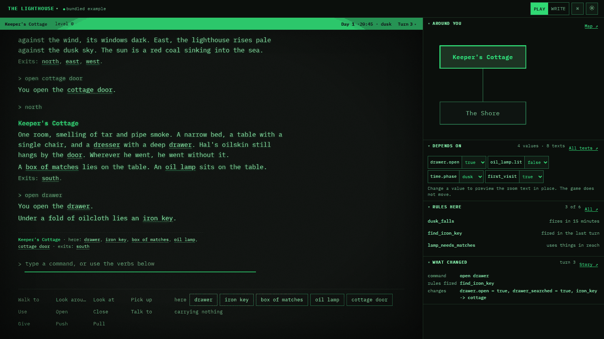
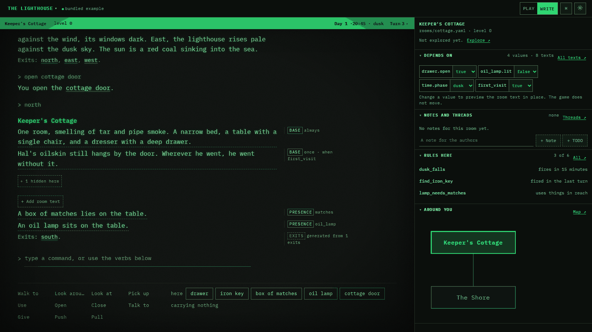
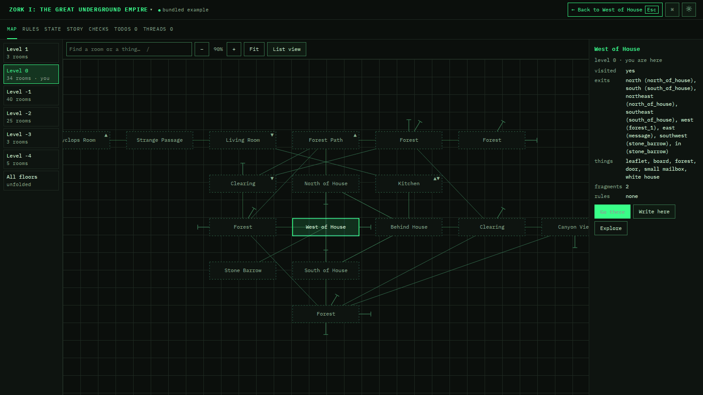

# loremaster

loremaster is a world editor for text adventures. In loremaster, each text in the game comes from the world state. The author can see which text shows, when it shows and why.

The core is in Rust. It uses [dramaturge](https://github.com/sunsided/dramaturge). The editor is a SvelteKit app. The player can play with typed commands or with a SCUMM-style verb bar. Both use the same runtime.

Try it in the browser: [sunsided.github.io/loremaster](https://sunsided.github.io/loremaster/). The browser version keeps your stories in the browser. For AI help and files on disk, install the command with `cargo install loremaster` and run `loremaster serve` (see [docs/ai-tools.md](docs/ai-tools.md)). The command contains the web editor.

## Examples and docs

| Path | Contents |
| --- | --- |
| `examples/lighthouse` | A small story. The tests, the terminal player and the web app use it. |
| `examples/terminal-host` | A small terminal host of the Session API: what a host must do. |
| `examples/salt-tower` | A small gamebook: sections as rooms, dice, stats and combat. |
| `examples/cantina` | A small story with a character whose name changes, and a dialogue with him. |
| `examples/zork1` | Zork I, imported from its ZIL source. A large map for tests. Read `examples/zork1/README.md`. |
| `examples/tower` | A spiral tower on four levels, for the level map. |
| `docs/writing-stories.md` | How to write a story: files, fragments, markup, conditions, frames, name stages, levels, and how to write in the game. |
| `docs/ai-tools.md` | How to connect an AI assistant to a project with MCP, the proposal format, the task prompts, the jobs and the HTTP endpoints. |

## Contributing

Read [CONTRIBUTING.md](CONTRIBUTING.md): the crates, the commands, how Trunk and SvelteKit work together, the design system, the writing rules and the branch flow. The changes are in [CHANGELOG.md](CHANGELOG.md).

## License

EUPL-1.2. Read [LICENSE](LICENSE).
