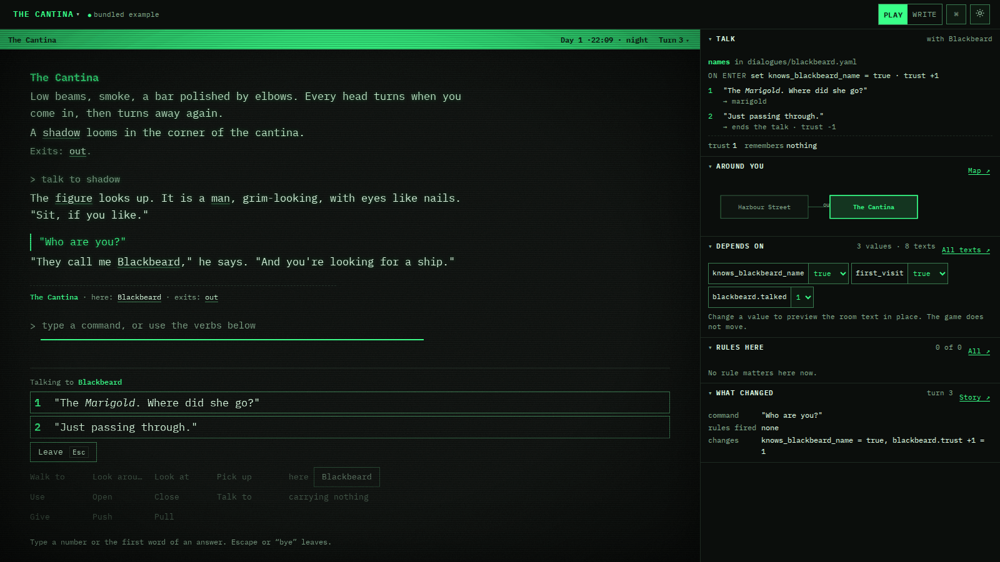

# Writing stories

This guide tells you how to write a story for loremaster. The examples are in `examples/lighthouse` and `examples/cantina`.

## Project folder

A story is a folder of YAML files. Each entity has its own file.

| Path | Contents |
| --- | --- |
| `story.yaml` | Title, start room, intro, clock and action costs, variables, custom verbs, the carry limit, the score and story frames. |
| `rooms/*.yaml` | One room in each file. A room file can also have rules. |
| `things/*.yaml` | One thing or character in each file. A thing file can also have rules. |
| `rules/*.yaml` | One rule, or a list of rules, in each file. Read [Rules](#rules). |
| `timers/*.yaml` | One timer in each file. Read [Timers](#timers). |
| `agendas/*.yaml` | One agenda of a character in each file. Read [Actors and agendas](#actors-and-agendas). |
| `endings/*.yaml` | One ending in each file. Read [Endings](#endings). |
| `assets/*.yaml` | One media asset in each file, next to its media file. Read [Media and sound](#media-and-sound). |
| `machines/*.yaml` | One puzzle machine in each file. Read [Puzzle machines](#puzzle-machines). |
| `verbs/*.yaml` | One custom verb in each file, as an item of `verbs:` in story.yaml. |
| `behaviors/*.yaml` | One file for each behavior in Rust, with notes about it. Read [Behaviors in Rust](#behaviors-in-rust). |
| `tests/*.yaml` | One walkthrough test in each file. Read [Walkthrough tests](#walkthrough-tests). |
| `threads/*.yaml` | One long-range thread in each file. Read [Author notes and threads](#author-notes-and-threads). |
| `dialogues/*.yaml` | One talk with a thing in each file. Read [Dialogues](#dialogues). |
| `texts/*.yaml` | One named text pool in each file. Read [Named text pools](#named-text-pools). |

The id of an entity is its file name. You can set `id:` to use a different id.

The loader reads only these files and folders, and only the fields that it knows. An unknown field, an unknown folder (also a folder inside a folder, such as `rooms/old/`) or another YAML file next to `story.yaml` is an error, so that a typo does not load as nothing. The error names the nearest known field or folder: ``unknown field `descripton`: did you mean `description`?``. Files that are not YAML, such as notes in Markdown, are not read.

To examine a story for problems, run `task check:story` or `cargo run -p loremaster --no-default-features -- check <folder>`.

## Start a new story

A new story has two files: `story.yaml` and the start room `rooms/start.yaml`. The start room has a placeholder text. Replace it with your text.

- In the terminal: `cargo run -p loremaster --no-default-features -- new <folder> --title "The Drowned Bell"`. The folder must not contain a `story.yaml`.
- In the editor: open the project menu or the command palette (Ctrl+K), then select "New story…". Type the title and push Enter. The browser keeps the story as a working copy. "Open my story …" in the same menu opens it again.
- With AI: type an idea too. The AI writes the first 2 or 3 rooms as a proposal. Read "Start a new story with AI" in `docs/ai-tools.md`.

## Fragments

A text is a list of fragments. A fragment is a plain string, or a map with these fields:

| Field | Meaning |
| --- | --- |
| `text` | The text, with inline markup. |
| `variants` | More texts for the modes `cycle`, `shuffle` and `sticky`. |
| `when` | A condition. The fragment shows only when the condition is true. |
| `mode` | `always`, `first_visit` (or `first_time`), `once`, `cycle`, `shuffle` or `sticky`. |
| `layer` | `base`, `ambient`, `event`, `objects`, `characters` or `exits`. |
| `replaces` | `true` hides the fragments before it in the same layer. |
| `id` | A stable name. The game keeps the progress of `once`, `cycle`, `shuffle` and `sticky` under it, so an inserted fragment does not move it. |
| `learn` | Story variables of type bool that become true when the fragment shows. |
| `pick`, `one_of` | A group in place of `text`: see below. |

`first_visit` shows on the first visit of the room, for a room and the presence text of a thing. For an examined thing, the intro and a frame it shows the first time the text would show. `shuffle` never shows the same variant twice in a row. `sticky` chooses a variant once and keeps it.

### Groups: one of several texts

A fragment with `one_of` shows one line of a group. dramaturge's text core chooses it; the fragment keeps its place, `layer` and `replaces` in the description.

```yaml
# things/stove.yaml
description:
  - id: stove_state
    pick: best
    one_of:
      - "The stove is cold."
      - when: stove.hot
        text: "The stove is still too hot to touch."
      - when: stove.hot and seen_by(player)
        text: "Someone fed the stove after midnight. The ash on the grate is fresh."
        learn: [ash_is_fresh]
```

`pick` is `first` (the default: the first candidate whose condition holds), `best` (the candidate with the most tests: each test in `when` counts 1, `a and b` the sum, `a or b` the smaller side, and `speaker` and `topic` 1 each; a tie goes to the file order) or `all` (every candidate that holds, as a plain fragment list). A candidate is a text, or a map with `key`, `when`, `mode`, `text` or `variants`, `learn`, `speaker` and `topic`, or an inner group (`id`, `pick`, `one_of`). `seen_by(x)` is true when `x` sees the text: the active actor (the player, unless the story has `playable` actors; see [Several player actors](#several-player-actors)).

### Named text pools

A file in `texts/` is a pool that rules and dialogues show by its id: the file name, or `id:` in the file:

```yaml
# texts/keeper_remark.yaml
pick: best
one_of:
  - "Mind your step."
  - when: in(kitchen)
    text: [{ says: "Do not touch the stove,", by: keeper }, { narrate: "the lock-keeper says." }]
  - when: in(kitchen) and ash_is_fresh
    key: midnight
    mode: sticky
    variants:
      - [{ says: "I let it go out at midnight,", by: keeper }, { narrate: "he says." }]
      - [{ says: "Cold stove, cold supper,", by: keeper }, { narrate: "he says." }]
```

A pool's texts are lines with speech segments. `say: { text: keeper_remark }` in a rule or in the lines of a dialogue node shows the pool; an option's `say` and a quest's `journal` cannot show one. A `sticky` line stays the same in every rule and dialogue that shows the pool. In a pool, `first_time` means the first visit of the current room. `loremaster check` warns about two `best` candidates with the same score that can both hold, and about a candidate with progress (`once`, `cycle`, `shuffle`, `sticky`) in a group or a pool that has no `key`; a pool that names an unknown pool is an error, as are two fragments of one text with the same `id` and two candidates of one `one_of` with the same `key`: they would share their progress. A fragment without an `id` and a candidate without a `key` are keyed by their index, so an `id: "0"` collides with the first one.

## Inline markup

| Markup | Result |
| --- | --- |
| `{night: moonlit \| sunlit}` | "moonlit" at night, else "sunlit". |
| `{first: , new to you,}` | The text only on the first visit. |
| `{lamp.lit ? glowing : dark}` | Any condition, with two texts. |
| `{weather}` | The value of a variable. |
| `{lamp.name}`, `{lamp.the}`, `{lamp.The}`, `{lamp.a}`, `{lamp.A}` | The current name of a thing, with an article. A proper name gets no article. |

## Conditions

Conditions use variables, thing properties and values that the runtime calculates:

- Variables and properties: `flooded`, `lamp.lit`, `sanity >= 3`, `weather == fog`.
- Time: `night`, `time.phase == dusk`, `time.hour`, `time.day`, `turns`.
- Place: `here == cellar`, `in(cellar)`, `cellar.visits`, `visited(cellar)`, `first_visit`, `level`.
- Things: `carried(lamp)`, `present(lamp)`, `lamp.location`, `lamp.interactions`, `lamp.talked`.
- Containers: `in(coin, trophy_case)` is true when the coin is in or on the trophy case, also deeper inside.
- Timers: `timer.fuse` is the number of turns left, 0 when the timer does not run. `timer.fuse.running` is true while it runs.
- Machines: `exorcism == lit`. The id of a machine is a variable with its state.
- The perceiver of a text: `seen_by(player)`, `seen_by(keeper)`. Only in the `when` of a fragment or of a candidate in `one_of`; `loremaster check` reports it anywhere else, where nobody perceives.
- Chance: `chance(30)` is true in about 30 of 100 turns. In one state, the result is always the same, so a game replays.
- The current action: `action.repeat`, `action.count`, `action.total`, `action.verb`.

Use `and`, `or`, `not` and parentheses to join conditions.

These names are built-ins of conditions: `and`, `or`, `not`, `true`, `false`, `here`, `turns`, `level`, `first_visit`, `time`, `action`, `timer`, `in`, `carried`, `present`, `visited`, `visits`, `chance`, `remembers` and `seen_by`. A variable, machine, room or thing must not use one of them as its id: a condition cannot name a keyword, it reads the built-in value instead of a `here` or `turns` of the story, and the function names are kept for the functions. The checker reports such an id as an error at its declaration. A variable or machine must not use the name of a phase of the clock (`night`, `dawn`, `day`, `dusk` by default) either: a bare `dusk` would read the variable instead of the phase.

## Action frames

An action frame adds author text around the response to a verb. Frames are optional. A story without frames plays as before.

```yaml
# story.yaml, a room file or a thing file
frames:
  look:
    before:
      - when: action.repeat == 1
        text: "You look around."
      - when: action.repeat == 2
        text: "You look around, again."
      - when: action.repeat >= 3
        text: "You keep looking around, and nothing seems to change."
```

A frame has three parts. All parts are lists of fragments:

- `before` shows before the response.
- `instead` replaces the default response when one of its fragments applies. Rules still fire.
- `after` shows after the response.

The runtime uses the most specific frame for the verb: the frame on the first thing of the command, then the frame on the current room, then the frame on the story.

The counters include the current action:

- `action.repeat` is the number of times in a row that the player gave the same command.
- `action.count` is the number of times that the player used the verb in this room.
- `action.total` is the number of times that the player used the verb in the game.

The room description that shows when the player enters a room is not an action. Frames do not apply to it.

## Name stages

A thing or a character can have names that change with the state. The last stage whose condition is true is the current name.

```yaml
# things/blackbeard.yaml
name: shadow
names:
  - { text: shadow, aliases: [figure, shape] }
  - { when: blackbeard.talked > 0, text: grim-looking man, aliases: [man] }
  - { when: knows_blackbeard_name, text: Blackbeard, aliases: [captain], proper: true }
```

- The text, the verb bar, the room brief and the default responses use the current name.
- The parser accepts the names of the current stage and of all stages before it. It does not accept a name that the player has not learned yet.
- Set `proper: true` for a proper name. A proper name gets no article.
- The author tooltip shows all stages and the current stage.

## Dialogues

A dialogue is a talk with a thing, for example a character. Put it in `dialogues/<id>.yaml`. The player starts it with "Talk to" and the thing.

```yaml
# story.yaml: the relations that dialogues can change
relations: [trust]
```

```yaml
# dialogues/blackbeard.yaml
with: blackbeard
start: [again, meet]
nodes:
  meet:
    say: ["The figure looks up.", { says: "Sit, if you like." }]
    options:
      - say: [{ says: "Who are you?" }]
        go: names
      - say: [{ says: "Not tonight." }]
        go: end
  names:
    say: [{ says: "They call me Blackbeard." }]
    set: { knows_blackbeard_name: true }
    relation: { trust: 1 }
    options:
      - say: [{ says: "Where did the *Marigold* go?" }]
        when: blackbeard.trust >= 1
        remember: [asked_marigold]
        go: back
  again:
    when: blackbeard.talked > 1
    say: [{ says: "Back again." }]
    options:
      - { say: [{ says: "Goodbye." }], go: end }
```

- `with` is the id of the thing.
- `start` is a list of node keys. The talk starts at the first node whose `when` holds.
- A node is one line of the thing (`say`). Its `options` are the answers of the player.
- More `lines` after `say` play in order, each with its `speaker`: a thing id, or `player` for a line of the player (it shows like an answer). A segment with `when` shows only while it holds, as in any line.
- `next` is where the talk goes on when the node has no answer that shows: a node key, `end` or `back`. The talk goes on in the same turn, and each node on the way shows its lines and applies its outcomes. `next: back` returns like `go: back`: the node before shows its lines again, without a check and without its outcomes. A node without answers and without `next` ends the talk. A loop of `next` without an answer in it is a check error; should one play anyway, the talk ends after 1024 nodes.
- A node with a `when` can only be entered while its `when` holds. When a `go` leads to a node whose `when` does not hold, the talk ends. `go: back` is no new entry: it returns to the node before and shows its line again, without a check and without its outcomes.
- An option has a `say` (the line of the player, and the text of the choice), an optional `when`, and `go`. `go` is a node key, `end` or `back` (the node before). Without `go`, the option ends the talk.
- A node or an option can change the state when it applies:
  - `set` and `add`: as in a rule.
  - `relation`: add to the relation of the player to the thing, for example `{ trust: 1 }`. Declare each relation in `relations` in `story.yaml`.
  - `remember`: memories that the thing keeps.
  - `then`: world effects, as in a rule: `move`, `goto`, `say`, `end`.
- `say` is a [line](#lines-and-speech): a text, or a list of narration and speech. The speech of a node is spoken by the thing (`with`), or by the node's `speaker`; the speech of an option by the player. The key of a node's or an option's line is always `say`.

Conditions can read the new values:

- `blackbeard.trust` is the relation of the player to the thing. It starts at 0.
- `remembers(blackbeard, asked_marigold)` is true when the thing keeps the memory.

During a talk:

- The story text shows only what is said: the answer of the player, then the line of the thing.
- In the web player, the answers are in the verb bar, as numbered buttons. Click an answer or push its number key. When the talk starts, the focus goes to the first answer.
- In the terminal, the answers show as a numbered list after the text. Type a number, or the first word of an answer.
- Each answer takes one turn.
- Other commands do not run. To leave the talk, type `bye` or `leave`, or push Escape.
- A talk ends when the player chooses an answer that ends it, when a node has no answer that shows and no `next`, or when an effect takes the player away.

The shape of a dialogue is the one of dramaturge's `dramaturge-syntax` (decision D3). Options can have an `id` (the key of the option), and the dialogue, nodes and options can have `notes`. The shape also has the option fields `hint`, `tags` and `intentions`; loremaster's talks do not play them yet, and `loremaster check` reports them as errors.

`loremaster check` examines each dialogue: keys, `start`, targets of `go`, conditions, markup, speakers, and nodes that no start node leads to.

### Lines and speech

A text that shows is a line: the `say` of a rule effect, of a dialogue node, of an option and of a machine step. `line:` is the same key as `say:` in effects (of rules, timers and a dialogue's `then`) and in machine steps. The `say` of a dialogue node or option is always `say:`: the dialogue shape is the one of dramaturge (see above). A line is one text, which is narration:

```yaml
say: "The lock-keeper shrugs."
```

Or a list of segments:

```yaml
say:
  - "The lock-keeper shrugs."                  # a bare string: narration
  - { says: "Prove it,", by: keeper }          # speech
  - { narrate: "he says." }                    # narration, written out
```

- `{ says: "…" }` is speech. The game puts straight double quotes around it, so write it without quotes: the line above shows `The lock-keeper shrugs. "Prove it," he says.`
- `by` names the speaker: a thing id or `player`. `player` always means the player, so in a story with speech, a thing with the id `player` gets a warning. Without `by`, the speaker is the thing of the dialogue in a node, the player in an option, and nobody in a rule. Front ends get the speaker with the text and can style the speech by it.
- `{ narrate: "…" }` and a bare string are both narration. Right after `says`, a bare string reads like more speech, so `loremaster check` warns there and suggests `narrate`.
- The segments that show join with one space. Each segment's text uses inline markup.
- A segment with `when` shows only while its condition holds. Use it instead of a choice with an empty branch:

  ```yaml
  say:
    - { narrate: "The chamber is empty.", when: in(lock_chamber) }
    - { narrate: "Water roars far below.", when: not in(lock_chamber) }
  ```

  There is no `else`: for the other case, write a second segment with the opposite condition. A bare string has no `when`; write `{ narrate: … }`.

`loremaster check` examines the markup and the `when` of each segment, and that each `by` names a thing or `player`.



In the editor, the room desk shows the dialogues of the things in the room. During a talk in write mode (Ctrl+E), you can change the line and the answers in the game text.

## Exits

An exit is a way from one room to a different room. Write the exits of a room in its file, one on each line:

```yaml
# rooms/shore.yaml
exits:
  - { direction: north, to: cottage, door: cottage_door }
  - { direction: east, to: stairwell, door: lighthouse_door }
  - { direction: west, blocked: "Cold surf breaks over the rocks. There is only the sea that way." }
```

| Field | Contents |
| --- | --- |
| `direction` | `north`, `northeast`, `east`, `southeast`, `south`, `southwest`, `west`, `northwest`, `up`, `down`, `in`, `out`, or a name. |
| `to` | The room that the exit goes to. |
| `door` | A thing that must be open. The player opens a closed door first. A locked door stops the player. |
| `visible` | A condition. When it is false, the exit is hidden and the player cannot use it. |
| `passable` | A condition. When it is false, the player cannot go through, and the game shows `blocked`. |
| `blocked` | Markup. The game shows it when the player cannot go through. |
| `traversal` | Markup. The game shows it when the player goes through. |

The player can type `back`, `go back` or `return` to go back to the room before. The game looks for a visible exit of the current room that leads to that room, and uses it with its door, `passable` and `traversal`. You do not have to write anything for this. When no exit leads back, for example after a one-way drop, the game says "You can't go back the way you came." An exit with the direction `back` replaces this.

### Message exits

An exit without `to` is a message exit. It goes to no room. When the player goes in its direction, the game shows `blocked`, and the player stays in the room. The move uses a turn, as a move that fails.

- A message exit must have `blocked`. The check gives an error for an exit without `to` and without `blocked`.
- `blocked` is markup, as in all exits. It can have conditions, for example `"{night: The surf is black. | Cold surf breaks over the rocks.}"`.
- `visible` works as in other exits. When it is false, the player gets the default response.
- A message exit does not use `door`, `passable` or `traversal`. The check gives a warning for them.
- The scene, the verb bar and the room brief do not show message exits, because they go to no room. The map shows a message exit as a short line out of the room that ends in a bar.
- In write mode, a new exit in the direction of a message exit replaces the message exit.

## Rules

A rule fires on an event. If its condition `when` is true, its effects `then` run.

```yaml
# rules/drawer.yaml
- id: find_iron_key
  on: { verb: [open, drawer] }
  when: not drawer_searched
  then:
    - set: { drawer_searched: true }
    - move: { iron_key: cottage }
    - say: "Under a fold of oilcloth lies an iron key."
```

The events:

| Event | When it fires |
| --- | --- |
| `start` | The game starts. |
| `turn` | Each turn, after the command. |
| `{ enter: room }`, `{ leave: room }` | The player enters or leaves the room. |
| `{ time: "21:00" }` | The clock reaches the time. |
| `{ check: [verb, thing] }` | Before the verb. Read [Action phases](#action-phases). `{ check: [go, north] }` checks a move. |
| `{ verb: [verb, thing, other] }` | After the default response of the verb, or instead of it with `instead: true`. Fewer parts match more commands. |
| `{ verb: examine, direct: stove }` | The same with named slots of the command. Read [The Command record](#the-command-record). `check` takes the same form. |
| `{ timer: fuse }` | The timer runs out. |
| `{ event: blast }` | An `emit: blast` effect sends the event. |
| `{ talk: [dialogue, node] }` | A dialogue reaches the node. `[dialogue]` matches all nodes. |

The effects:

| Effect | What it does |
| --- | --- |
| `set: { name: value }` | Sets variables and properties. |
| `add: { name: 1 }` | Adds to number variables. |
| `calc: { total: "r + skill - 1" }` | Sets a number variable or property to a sum of whole numbers and number variables or properties, with `+` and `-`. The sum reads the values from before the effect. |
| `say: "text"` | Shows the text. Inline markup is permitted. The text can also be a list of narration and speech: read [Lines and speech](#lines-and-speech). `line:` is the same key. |
| `move: { thing: place }` | Moves things. The place is a room, `carried`, `nowhere`, `in:box` or `on:table`. |
| `goto: room` | Moves the player. Leave and enter rules fire. |
| `end: beacon_lit` | Ends the game with an ending from `endings/`. Read [Endings](#endings). |
| `stop` | Stops the action. Read [Action phases](#action-phases). |
| `emit: name` | Sends a custom event. Rules `on: { event: name }` fire immediately. |
| `start: fuse` or `start: { fuse: 6 }` | Starts a timer, with its own turns or with a number of turns. |
| `cancel: fuse` | Stops a timer. Its rules do not fire. |
| `call: thief` | Runs a behavior in Rust here, at this place in the rule. Read [Behaviors in Rust](#behaviors-in-rust). |
| `await: { … }` | Stops the rule until the host answers. Read [Wait for the host](#wait-for-the-host). |

More fields: `once: true` lets the rule fire only one time in a game. `instead: true` makes a verb rule replace the default response. `closes: [<ending ids>]` with a `reason` names the endings that the rule closes on purpose (read [Dead ends and points of no return](#dead-ends-and-points-of-no-return)).

### The Command record

Each command has these slots: who acts (`actor`), the `verb`, the first object (`direct`), the second object (`indirect`), the word between the objects (`preposition`) and what the command is about (`topic`). In `unlock door with key`, the verb is `unlock`, `door` is direct, `key` is indirect and `with` is the preposition. In `go north`, the direction is direct.

A `verb` or `check` event can name the slots:

```yaml
- id: keeper_comments
  on: { verb: examine, direct: stove }
  when: present(keeper)
  then:
    - say: "The keeper looks up."

- id: keeper_feeds_the_stove
  on: { verb: open, direct: stove, actor: keeper }
  then:
    - set: { stove.hot: true }
```

- A slot that the event does not name matches any command.
- `actor` is different: an event without `actor` matches only the player's commands. Then the rules for the player do not fire when a character acts. `actor: player` says the same, and `actor: keeper` matches the commands of the keeper's agenda. Read [Actors and agendas](#actors-and-agendas).
- The list form `verb: [unlock, door, key]` is the same as `{ verb: unlock, direct: door, indirect: key }`. Both forms load into one model.
- The verb `"*"` (with quotes: a bare `*` is YAML syntax) matches any verb. `verb: ["*", darkness]` fires for each command on the darkness. When a rule with an exact verb, such as `[examine, darkness]`, fires in the same scope (the same thing, room or region, or the rules folder) and phase (`check`, `instead` or `after`), the `*` rule does not fire for that command. A `*` rule with `once` fires once for all verbs. It also matches verbs that the story adds later. An agenda step's `do` takes one verb, not `*`.
- The parser fills `preposition` with the word that you typed.
- The parser fills `topic` with the words after `about`, in lower case, with punctuation as spaces and without articles: `ask Bert about the Lantern!` has the direct object `bert` and the topic `lantern`. The topic is words, not a thing, so it can name things that are not here. Write `topic:` in that form; `loremaster check` reports a topic such as `the lantern` that the parser never gives. A verb without objects has no topic, and for a two-object verb whose `preposition` is `about`, the words after it are the second object; `loremaster check` reports a `topic:` on such verbs. The explorer tries the topics that rules name.

`ask` and `show` are custom verbs. `show` is a verb with two objects, as `give`:

```yaml
# verbs/ask.yaml
label: Ask
words: [ask]
default: "They have nothing to say about that."

# verbs/show.yaml
label: Show
words: [show]
slots: two
preposition: to
default: "They look at it and say nothing."
```

```yaml
- id: bert_lantern
  on: { verb: ask, direct: bert, topic: lantern }
  then: [{ say: "Two lights on the gate, sir." }]
- id: bert_boots
  on: { verb: show, direct: boots, indirect: bert }
  then: [{ say: "Those are Mr Marsh's, sir." }]
```

### Wait for the host

`await` stops a rule. The host, for example the web player or a game engine, gives the answer, and the rest of the rule runs with it. One `await` asks for one of these:

| Request | The answer |
| --- | --- |
| `choice: [left, { id: right, text: "the right door" }]` | One of the options. A player types its number, its id or its text. |
| `roll: 2d6` | A number from the dice. The game rolls itself, unless the host rolls (`set_host_rolls`). |
| `walk_to: dock` | `arrived` or `refused`. With `arrived`, the player is in the room. A stage host also gets a `walk_to` with a `thing` or an `exit` before a command (see [Scenes with hotspots](#scenes-with-hotspots)). |
| `action: open_sluice`, with `args` and `results` | One of the `results`. The host does the action, for example an animation. |

`into: path` keeps the answer in a variable: an enum variable that has all answers, or a number variable for a roll.

```yaml
- id: pull_lever
  on: { verb: [pull, lever] }
  instead: true
  then:
    - say: "A voice asks: left or right?"
    - await: { choice: [left, right], into: path }
    - say: "You go {path}."
```

While a rule waits, the player can only answer. The answer is not a new turn: the clock and the timers do not move. A save game keeps the waiting rule. `await` works only in rules, not in dialogues or timers.

### The interface: a contract with the host

A story that a game engine hosts can declare everything it asks of the host and everything the host can report, in one section of story.yaml:

```yaml
interface:
  actions:
    - { id: lockpick, args: { difficulty: int }, results: [success, failure, broken_pick] }
  events:
    - { id: killed, args: { boss: text, level: int }, when: "not game_over" }
```

An argument type is `bool`, `int`, `text` or `{ enum: [a, b] }`. An `await` of a declared action can leave out `results`. The ids, arguments, results and enum values become names in the host's code: they are plain names (lowercase letters, digits and single `_`, from a letter on), and two of them must not make one Rust name (`level_2` and `level2`). An event argument cannot have the name of a thing property such as `name` or `location`. The `when` of an event sees the reported arguments (`when: "killed.level > 0"`); when it is false, the session refuses the event and keeps the values before. An event cannot have the id of a thing, a variable, a room, a keyword or a built-in path such as `time`.

With the section, `loremaster check` fails when:

- a rule calls an action that is not declared, or gives an argument of the wrong type;
- the `results` of an `await` are not the declared ones;
- an action with two or more results has no `into`, or no condition or text names `into` and a result (`lock == broken_pick`). Each result needs a branch;
- a rule listens for an event that nothing emits and that is not declared, or emits one that no rule hears and that is not declared. An event that the story both emits and hears is its own and needs no declaration.

Rules hear a host event with `on: { event: killed }`. Its arguments read as `killed.boss`: the last reported value. The host reports it with `Session::host_event`. The session refuses an undeclared event, a wrong argument, a false `when`, and an event while a rule waits. An event is not a turn: the clock does not move.

`Session::for_host` refuses to start when the host was built for another interface: the message names the added, removed and changed entries. In a walkthrough, an `await` of an action takes only a declared result, by name, and a step `{ event: killed, args: { boss: ogre } }` reports an event. A step has `do` or `event`, not both.

A Rust host gets its types from the `loremaster-build` crate in `build.rs`, or from `world!`, which writes the module `interface`. `loremaster interface <project> --ts` or `--json-schema` writes them for other languages. `loremaster protocol <project>` plays the story as a JSON-RPC 2.0 server on stdio, one message per line, for hosts in any language.

### Combat

The effect `combat` runs a fight by built-in rules. The player needs the number variables `skill` and `stamina`, and can have `luck`. An enemy is a thing with the number properties `skill` and `stamina`.

```yaml
- id: fight_warden
  on: { enter: gate }
  then:
    - combat: { enemies: [warden], win: yard, loss: fallen, escape: road }
```

`win`, `loss` and `escape` are rooms. `escape` is optional. With `together: true`, all enemies fight in the same round; without it, they fight one after the other. Effects after `combat` run in the room where the combat ends.

In each round, the player selects "Attack" or, if the combat has `escape`, "Escape". The enemy and the player each roll 2d6 and add their `skill`. The enemy rolls first. The higher total hits and takes 2 `stamina`, unless the enemy has a special rule (`deals` or `takes`, below). In an all-at-once combat, each enemy rolls and the player rolls once. While more than one enemy lives, the player selects the target: "Attack GATE WARDEN" (`attack`, the first living enemy) or "Attack HOUND" (`attack.hound`). The other enemies only attack.

Special rules of one enemy are its number properties `deals` (the `stamina` a hit of the enemy costs the player, instead of 2) and `takes` (the `stamina` a hit of the player costs the enemy, instead of 2). Both are 0 or more: `loremaster check` rejects a negative value, and the combat counts a negative value that a rule sets as 0. A Luck test shifts these values as it shifts the 2, and is not offered for a wound that costs nothing. For a rule of one combat, a rule sets the property before the combat starts, for example "the troll takes 1 extra damage from fire". The troll declares `takes: 2` in its `props`, and:

```yaml
- id: torch_burns_troll
  on: { enter: bridge }
  when: "carried(torch)"
  priority: 1
  then:
    - set: { troll.takes: 3 }
- id: fight_troll
  on: { enter: bridge }
  then:
    - combat: { enemies: [troll], win: far_bank, loss: fallen }
```

After a hit, the player can select "Test your Luck" or "Go on", when `luck` is more than 0. The roll is 2d6 against `luck`, and the test costs 1 `luck`. A lucky result on a hit: the enemy loses 2 more. An unlucky one: the enemy loses 1 less. A lucky result on a wound: the player loses 1 less. An unlucky one: the player loses 1 more. If more than one hit happens in a round, the test changes the last one. A test is not offered for a hit that already kills the enemy, or for a wound when the player has 1 `stamina`.

Escape costs 2 `stamina`. If that is the last `stamina`, the combat ends in `loss`.

In a walkthrough, each step answers one question. `rolls:` has the enemy totals, then the player total:

```yaml
- { do: attack, rolls: [5, 11] }
- { do: "Test your Luck", rolls: [4] }
```

With `set_host_rolls(true)`, the host rolls the dice of a combat too: after the answer to the round, the session waits for one `roll` await (2d6) for each enemy that fights, in the order of `enemies`, then one for the player. "Test your Luck" waits for one more. The dice display shows the totals when the round is over.

In `world!`, the effects are `await roll "2d6" into r against luck;`, `await choice [left, right "the right door"] into path;`, `await walk_to dock;`, `await action open_sluice { force = 2 } results [open, stuck] into sluice;` and `combat [warden] win yard loss fallen escape road;` (with `together` for all at once). The builder has `.awaits(AwaitSpec { .. })` and `.combat(CombatSpec { .. })`.

`combat` works only in rules. The `min` of `stamina` must be a number of 0 or less, not a variable, and an enemy can be named only once. The explorer tries the win and the loss of a round and the escape. It does not try Luck tests, and it does not force rounds of an all-at-once combat in which the player hits and an enemy hits too.

### The adventure sheet

`stats:` in story.yaml declares the sheet that the web player shows. A story without `stats:` shows no sheet.

```yaml
stats:
  - { var: stamina, label: STAMINA, short: ST, max: stamina_initial }
  - { var: gold, label: Gold }
  - { var: hearth, label: HEARTH }
```

In `world!`, the header takes `stats { stamina "STAMINA" short "ST" max stamina_initial, gold "Gold" }`; the builder has `.stat("stamina", "STAMINA").stat_short("stamina", "ST").stat_max("stamina", "stamina_initial")`.

`var` is a number or a true/false variable, or a number or true/false property of a thing. Each variable can show one time only. A number shows as its value, with "/ max" when the stat has `max` (a number or a number variable). A true/false value shows as a codeword when it is true. A number with `short` also shows in the one-line sheet on a phone. The equipment on the sheet is the inventory of the player.

### Number limits and sums

A number variable can have limits, written as `min` and `max` in `story.yaml`: a number, or the id of another number variable.

```yaml
vars:
  - { id: stamina_initial, type: int, initial: 20 }
  - { id: stamina, type: int, initial: 20, min: 0, max: stamina_initial }
```

The engine clamps the variable after each write: `set`, `add`, `calc`, the `into` of an `await`, a behavior and the outcomes of a talk. A limit that names a variable reads its value at the write.

Conditions compare a variable with a constant. For `$r + skill >= 9`, write the sum into a variable first:

```yaml
- await: { roll: 2d6, into: r }
- calc: { total: "r + skill" }
```

Then a later rule tests `total >= 9`.

`against: luck` on a roll shows the target on the dice display of the web player ("7 against LUCK 9"). It names a number variable and changes nothing else: the story still compares the values.

### Action phases

A verb goes through these phases:

1. `check` rules. A check rule with `stop` refuses the action. Then no other phase runs, but the turn passes. A check rule that waits for the host (`await`) also holds the action: the later phases do not run, also after the answer. For an actor's command, the step of its agenda still counts as done, and its `then` runs at once, before the answer. Such a rule must do the move or the action itself.
2. `instead` rules (verb rules with `instead: true`). If one fires, it replaces the default response.
3. The default response of the verb, or an `instead` frame.
4. The other verb rules. They can read the result of the default response, for example `lamp.lit`.
5. The `after` frame, then turn rules, timers and time rules.

```yaml
- id: dead_lamp
  on: { check: [turn_on, lamp] }
  when: not timer.lamp_battery.running
  then:
    - say: "A burned-out lamp won't light."
    - stop
```

`stop` in an `instead` or a verb rule stops the rules after it in that phase, and the later phases.

### Scope and priority

Put a rule in a thing file or a room file, under `rules:`. Or give a rule `within: <thing, room or region>`.

- A thing rule fires for verbs on that thing. For other events, it fires while the thing is present.
- A room or region rule fires while the player is in the room or region.

In one phase, thing rules run first, then room rules, then region rules, then story rules. In one scope, a higher `priority` runs first. Rules with the same priority run in file order.

```yaml
# things/rug.yaml
rules:
  - id: rug_too_heavy
    on: { verb: [take] }
    instead: true
    then:
      - say: "The rug is extremely heavy and cannot be carried."
```

## Media and sound

A room, a thing or a machine state can have media slots: `illustration`, `portrait`, `music` and `ambience`. A slot names assets by id. It is one id, or a list of variants, and the first variant whose `when` holds is the active one.

```yaml
# rooms/road.yaml
media:
  illustration:
    - { asset: gate_open, when: iron_gate.open }
    - gate_closed
  ambience: wind
  music: calm
```

Machine states take `media` in the long form: `{ name: ringing, media: { music: alarm } }`. The strongest slot wins: a machine state, then the partner of a talk or a fight, then the room. The partner's `portrait` shows during the talk. Music and the other slots come from the state after each step, so they are not in a save.

Each asset is a file in `assets/`:

```yaml
# assets/gate_creak.yaml
file: assets/gate_creak.wav
caption: "[The gate creaks on its hinges.]"
licence: { name: CC0-1.0, author: Ada, source: made for this story }
```

`file` is relative to the project folder. `caption` is the alt text of an image and the caption of a sound. An image or a sound effect without information has `decorative: true` instead. A music or ambience asset needs no caption, but one that carries information should have it.

`play_sound` is a rule effect. It plays once, and is not saved:

```yaml
then:
  - play_sound: gate_creak
```

A walkthrough checks it with `sound:`, in a step or in `expect`: `{ do: open gate, sound: gate_creak }`.

`loremaster check` reports an unknown asset, a file that does not exist and a path outside the project as errors. An asset without a licence, an unused asset and a missing caption are warnings.

The web player shows the images and plays the audio. The sound is off by default; Alt+M switches it. Audio starts after the first input of the player. Captions show while the sound is off, or with the Captions switch. The web player has the files of the bundled examples only: a story from a folder or a zip shows the captions in place of its media.

### Scenes with hotspots

A variant of a room's `illustration` can have `regions`: hotspots that point to a thing or to an exit of the room. `rect` is left, top, width and height, in percent of the image, so the story keeps no pixels.

```yaml
# rooms/road.yaml
media:
  illustration:
    asset: gate_closed
    regions:
      - { thing: iron_gate, rect: [31, 33, 38, 67] }
      - { thing: rope, rect: [68, 8, 8, 54] }
```

A region of an exit names its direction: the yard of the example has `{ exit: south, rect: [40, 25, 20, 30] }` on the gate in its wall.

`Session::media()` lists the hotspots whose thing the player can see in the room (not carried) and whose exit is visible, each with its name now. A click on one is a command on the thing, or `go` through the exit. In the web player, the hotspots are buttons over the illustration: Tab reaches each one, and a click uses the verb of the prompt, or looks at the thing. `loremaster check` reports a region with an unknown thing, an exit the room does not have, both or neither, a `rect` outside the image, and regions on another slot.

A stage host that animates the walk calls `set_host_walks(true)`. Then a command on a thing in the room, or a move, first waits for `walk_to` with the `thing` or the `exit`; `arrived` runs the command, and `refused` drops it. Time passes when the command runs, not while the walk waits. Without it, as in the web player, the walk happens at once.

## Endings

An ending is a way the story can end. Put each ending in `endings/<id>.yaml`. The `end` effect names it by its id.

```yaml
# endings/beacon_lit.yaml
kind: win
rank: 1
title: The beacon is lit
text: "{night: Far below, the *Marigold*'s masthead light turns, and steadies, and comes home. | Hours early, the beam goes round and round.}"
```

```yaml
# rules/beacon.yaml
- id: light_the_beacon
  on: { verb: [turn_on, lens] }
  then:
    - end: beacon_lit
```

| Field | Meaning |
| --- | --- |
| `kind` | `win`, `loss`, `death` or `neutral`. |
| `rank` | The order of the endings: 1 is the best. Optional, for example for deaths. |
| `title` | The name of the ending. The game shows it above the text. |
| `text` | The text, with inline markup. Optional. |

- When an `end` effect runs, the game shows the title and the text, and the game ends. The save game keeps the id of the ending.
- `loremaster check` gives an error for an `end` that names no ending, and a warning for an ending that no `end` names.
- A walkthrough checks the ending with `ending:`, for example `expect: { ending: beacon_lit }`.
- An ending of kind `death` asks the player to undo the last input, restart or restore a save (the death prompt). A walkthrough step `undo` goes back one input. `death_prompt: false` in story.yaml turns the prompt off.

### Dead ends and points of no return

The state explorer (`loremaster explore`, or Atlas › Checks › "Whole game") checks the endings. It walks back from the endings over the states it explored:

- A **dead end** is a state from which no ending can be reached, the softlock of early King's Quest. This is an error. The explorer gives the shortest command list into it, the room and the rule that fired on the last turn.
- A **point of no return** is a turn after which the best ending that can still be reached gets worse, by `rank`. This is a warning. Endings without a rank are worse than every ranked ending. A reached ending, also a bad one, resolves the game: the turn into an ending is neither a dead end nor a point of no return.

Some points of no return are on purpose. Name the endings that a rule or a machine step closes in `closes`, and say why in `reason`:

```yaml
# rules/burn.yaml
- id: keeper_burns_the_pages
  on: { time: "00:00" }
  when: in(pages, gear_housing)
  then:
    - move: { pages: nowhere }
  closes: [committed]
  reason: "The keeper burns the pages at midnight. A late player gets the ashes ending."
```

- The check compares the list with the endings that really drop out. It accepts a point of no return when each ranked ending that drops out is in the `closes` of a rule that fires on the turn, or that can still fire after it. The second case covers the turns before a timed step, after which the player is too late.
- A ranked ending that drops out and that no `closes` names is a warning at the rule. A `closes` that names an ending that never drops out at the rule is a warning too.
- `loremaster check` gives an error for an unknown ending in `closes`, and for `closes` without a `reason`.
- Agenda steps (`agendas/`, P4-02) take the same `closes` and `reason`.
- When the budget stopped the walk, the checks are **not proven**: the explorer reports only dead ends and points of no return that it proved, and says that the rest is not proven. "No dead end" holds only for a walk that finished.
- The explorer tells states apart by the turns left of each running timer, because a timer that runs out can change the story. A timer of n turns can make the walk up to n times larger: a story with a long timer needs a bigger budget, or a shorter timer, for proven checks.

## Timers

A timer counts down by one each turn. Put it in `timers/*.yaml`, or in a `timers:` list in story.yaml.

```yaml
# timers/lamp_battery.yaml
turns: 385
running: true
runs_while: lamp.lit
at:
  15: [{ say: "The lamp is nearly out." }]
  0: [{ set: { lamp.lit: false } }]
```

| Field | Meaning |
| --- | --- |
| `turns` | The turns from the start value to zero. |
| `running` | `true`: the timer runs from the start of the game. Else, a `start` effect starts it. |
| `runs_while` | The timer counts down only while this condition is true. |
| `at` | Effects at a number of turns left. At 0 the timer runs out. Then rules `on: { timer: id }` fire. |
| `repeat` | `true`: the timer starts again when it runs out. |

The turns left are part of the save game. In the Atlas, "State" shows them as `timer.<id>`, and you can set them.

## Actors and agendas

An actor is someone who acts: the player, and each thing with an agenda, such as a character. A thing that acts has a place, its location, as any thing has. Its agenda is a list of steps: at a time of day, or when a condition holds, it goes to a room and does something. Put each agenda in `agendas/<id>.yaml`.

```yaml
# agendas/keeper.yaml
actor: keeper
steps:
  - at: "00:00"
    place: kitchen
    when: in(pages, gear_housing)
    then:
      - move: { pages: nowhere }
      - set: { stove.hot: true, pages_burned: true }
      - say: "{in(kitchen) ? The lock-keeper feeds the stove. | You smell smoke from the kitchen.}"
    closes: [committed]
    reason: "The keeper burns the pages at midnight. A late player gets the ashes ending."
```

| Field | Meaning |
| --- | --- |
| `actor` | The thing that acts. An actor has one agenda. |
| `steps` | The steps, in order. |
| `id` | The id of the agenda. Without it, the file name. |

The fields of a step:

| Field | Meaning |
| --- | --- |
| `at` | The time of day from which the step is due. The first step is due the first time the clock reaches it; each later step the first time the clock reaches it after the step before was due. A step without `at` is due as soon as the step before it is over. |
| `place` | The room where the step happens. The actor walks there along the exits, one room per turn. Doors and conditions on exits do not stop it. When no exits lead there, it goes there in one turn. |
| `when` | A condition. The actor tests it in each turn while the step is due, also while it walks to the `place`. A step with `at` is skipped in the first turn in which its condition does not hold, also when that is on the way. A step without `at` waits until its condition holds. |
| `do` | A command of the actor: `{ verb: open, direct: stove }` or `[open, stove]`. Its `check` and verb rules fire with the actor in the [Command record](#the-command-record). The default responses of the standard verbs are the player's and do not run, so a rule with `actor:` makes the command do something. A `check` rule with `stop` refuses it; then the step is skipped and its `then` does not run. The refused try takes the actor's turn. |
| `then` | Effects, as in a rule. `await` does not work here. |
| `closes` | The endings that the step closes on purpose: after it, the story can no longer reach them. Read below. |
| `reason` | Why the step closes them. `closes` without a `reason` is an error of `loremaster check`. |
| `id` | The step's name in the save game. Without it, the step's place in the list, from 1. |

How a turn goes for an actor, after the clock moved and the timers and time rules ran:

- An actor does one thing per turn: it walks one room, runs one step, or tries a `do` that a `check` rule refuses. A step skipped for its `when` takes no time.
- While the player talks with the actor, the actor waits. Its step runs late, in the turn that ends the talk.
- The player sees an actor come into the room and leave it ("The lock-keeper comes in.").
- A step runs once. A save game keeps which steps ran and which were skipped.

`closes` marks a point of no return, for the ending checks. It is not a dead end: after the keeper burns the pages, the best ending (`committed`) is gone, but the game can still end (`ashes`). A drop in the best reachable ending is a warning, unless the step names the ending in `closes`; a dead end, where no ending can be reached at all, is an error. `loremaster check` checks today that `closes` names known endings.

The explorer (`loremaster explore`) waits in a story with agendas, as it does for timers. It tells states apart by the minutes until each agenda's next step, so it reaches a step also in the middle of a phase. The ending checks treat a step's `closes` as they treat a rule's; their findings name the step as `agenda:<id>/steps[<i>]`.

## Several player actors

A story can give the player more than one body. List the actors in story.yaml; each is a thing in a room, with `container: true`. The first one starts the story and must be in the `start` room.

```yaml
# story.yaml
playable: [wick, bilge]
```

```yaml
# things/wick.yaml
name: Wick
proper: true
container: true
location: { room: gallery }
props: { active: true }
```

- `switch to bilge` (also `become`, `control`) makes Bilge the active actor. It takes no turn and shows Bilge's view of its room. A switch is no entry: Bilge stood there already, so no `enter` rule runs and no visit counts. Only a story with `playable` has this verb.
- The active actor is the player's body: `State.room`, the carried things and the default actions are its own. The active actor is not listed in the room. The things another playable actor carries are `in` it, so they are out of reach and do not count for `carried`.
- `seen_by(bilge)` shows text only to Bilge. The perceiver of a text is the active actor.
- `bilge.active` is true while the player steers Bilge, for rule conditions. Declare it as a property to use it in a rule.
- An order to another actor: `bilge, take spanner` or `bilge, s then turn port wheel`, or a `Command` record with `actor: bilge`. An order takes the player's turn; each step then runs in one turn, after the agendas, as that actor. The player reads what the actor perceives as it acts, and the actor reports when it is done. A new order replaces the old one. A switch to the actor cancels its orders. A step that the parser cannot read ends the order.
- `loremaster check` wants each playable actor in a room, `container: true`, not `portable`, and without an agenda.

The active actor is in the save (`State.active`, `State.orders`). The state explorer tries a `switch`, but not orders: they reach the same states. Read `examples/two-robots`.

## Containers and scenery

A thing with `container: true` can hold things. A thing with `supporter: true` can have things on it. Put a thing in or on another one with `location: { in: box }` or `location: { on: table }`.

```yaml
# things/trophy_case.yaml
name: trophy case
location: { room: living_room }
container: true
capacity: 20
listed: false
props: { open: false, transparent: true }
```

- The player uses `put coin in case` or `put coin on table`.
- A container with an `open` property holds its contents only while it is open. While it is closed, the player can not see or take them. With `transparent: true`, the player can see them, but not take them.
- `capacity` is the number of things that fit. Without it, any number fits.
- The room text, `examine`, `open` and the inventory tell the contents.
- The contents move with their container. A carried bag carries what is in it.

Scenery can be in more than one room. `also_in: [forest_1, forest_2]` or `also_in: [forest]` (a region) puts the thing in these rooms too, while its location is not `nowhere`.

### Concealed things

A thing with `concealed: true` in its properties is hidden: it is not in the room text, the contents or the inventory, and the player can not name it. Put it in or on the thing that hides it. The verb `search` (also `look under`, `look behind`, `look in`) reveals the concealed things in or on its object: "You find a brass key." A rule reveals a thing with `set: { key.concealed: false }`. The contents of a concealed thing are hidden too.

```yaml
# things/key.yaml
name: brass key
location: { on: rug }
portable: true
props: { concealed: true }
```

A door can be concealed too: the player can not name it, but the exit stays. Going through it opens it without a note; while it is locked, the player reads "The way north is locked." To hide the exit as well, give it a `visible` condition. The explorer searches each thing that hides something it can find.

### Carry limit

`carry_limit: 4` in story.yaml is the number of things that the player can hold. A `take` beyond it says "Your hands are full." Things in a carried bag do not count, so a bag lets the player carry more. A concealed thing in the hands does not count either, since the player can not name it to drop it. A rule that moves a thing to `carried` does not check the limit. In a story with a limit, the explorer drops what the player holds when the hands are full, and it tries a `take` with full hands only when a rule listens to `take`.

## Action cost

A turn moves the clock by `minutes_per_turn`. `costs` in the clock gives a verb its own number of minutes, for the standard verbs and for custom ones. A cost of 0 lets a verb take no time; the turn still counts.

```yaml
# story.yaml
clock:
  start: "22:00"
  minutes_per_turn: 1
  costs: { search: 10, wait: 15, go: 5 }
```

The cost is for the player's command. A tick of the host and a choice in a talk take `minutes_per_turn`; leaving a talk takes no time. Actors act in the player's turn and have no cost of their own. Timers count turns, not minutes; time rules and agenda steps see the minutes, so a long search can let the clock pass midnight.

## Score

```yaml
# story.yaml
score:
  max: 350
  ranks:
    - { from: 0, name: Beginner }
    - { from: 26, name: Amateur Adventurer }
```

With a score, the command `score` shows the score, the moves and the rank. The score is the number variable `score`. Set `var:` for a different variable. If story.yaml does not declare the variable, the loader declares it. Rules change the score with `add: { score: 10 }`.

## Puzzle machines

A machine is a puzzle with named states and steps between them. Use a machine for a puzzle with an order, such as a ritual or a dam.

```yaml
# machines/exorcism.yaml
start: idle
states: [idle, rung, lit, done]
steps:
  - from: idle
    on: { verb: [ring, bell] }
    to: rung
    instead: true
    say: "The bell suddenly becomes red hot."
    then: [{ start: exorcism_window }]
  - from: rung
    on: { verb: [turn_on, candles] }
    when: candles.carried
    to: lit
  - from: [rung, lit]
    on: { timer: exorcism_window }
    to: idle
```

- A step fires on its event when the machine is in one of its `from` states and `when` is true. Then the machine goes to `to`, shows `say` and runs `then`.
- A machine takes one step for one event only.
- A step with `on: next` needs no event. It runs by itself right after a step brings the machine to one of its `from` states, in the same turn, and when the game starts in that state. A change of the machine's variable with `set` does not run it. Of several such steps of one state, the first whose `when` holds runs, in file order. These steps chain, and they can go back to an earlier state, so they make a loop.
- An `await` in such a step waits as in a rule. After the answer, the chain goes on. A save in the middle restores.
- A `stop` in such a step ends the chain of that machine. At the start of the game, the chains of other machines still run. When an event started the chain, the `stop` also ends the other rules of that event, as any `stop` does.
- `step_limit: 100` in story.yaml is the most `on: next` steps in one turn, counted anew after each answer to an `await` (100 by default). At the limit, the chain of steps stops with a note; the rest of the turn goes on. A loop that steps can reach from the start state, where no step has `when`, `await`, `end` or `stop`, is an error of the checks: it can never stop. A loop that only a `set` of the machine's variable can enter is not checked; the step limit stops it. `on: next` is an error in a rule outside a machine.
- The id of the machine is a variable with its state. Conditions read it: `exorcism == lit`.
- Each step is a rule with the id `<machine>#<number>`. The rules view, the checks and the explorer show them.
- Without `states`, the states are the start state and all states that the steps name.
- A step can name the endings that it closes on purpose, with `closes: [<ending ids>]` and a `reason`, as a rule can. Read [Dead ends and points of no return](#dead-ends-and-points-of-no-return).
- A state in the list can be a map with a description for the authors: `{ name: rung, description: The spirits are stunned. }`. The player does not see it.

In the editor, Atlas › Machines shows each machine: the states in a row, and the steps as numbered arrows. Forward steps are above, steps back are below. The current state is filled. A step that the next event can take is marked. Point at a state or a step to light its connections. Select a state to see its description and its steps in and out on the right. There you can also change the description, rename the state, or delete a state that no step uses. "+ State" under the drawing adds a state. A rename changes the start and the steps of the machine, but not conditions in other files, such as `exorcism == lit`. The checks show these.

The checker finds unknown states and states that no step goes to.

### Quests

A quest is a machine with `quest: true`. Its states give the player's journal: a state with `journal:` text shows the quest in the journal, and `done: true` marks the quest as finished in that state. A state without `journal:` keeps the quest out of the journal, for example before the player hears of it.

```yaml
# machines/pages.yaml
quest: true
title: The missing pages
start: unknown
states:
  - unknown
  - { name: searching, journal: "Find the pages of the lock log." }
  - { name: found, journal: "You found the pages.", done: true }
steps:
  - { from: unknown, on: { verb: [ask, keeper] }, to: searching }
  - { from: searching, on: { verb: [take, pages] }, to: found }
```

- `title` is the name in the journal. Without it, the journal shows the id.
- The journal text is a line: markup and speech segments work.
- The steps move the quest, and so does `set: { pages: found }` in a rule or in a dialogue's `then`.
- The player types `journal` to read it. It takes no turn. Hosts read it with `Session::journal()`, open quests first.
- The checker warns about a quest without journal text, and about `journal`, `done` or `title` on a machine without `quest: true`.

## Behaviors in Rust

Some logic is too large for rules, for example a character that walks the map and steals. A game that uses loremaster as a library can write this logic in Rust as a behavior.

1. Write a type that implements `loremaster_runtime::Behavior`. Its `handle` method gets each event, after the rules of the event.
2. Read and change the world only through `Cx`. It reads facts, locations, the player's room (`here`), `neighbours`, `carried` things, `present`, `room_has_tag`, `visited`, `turns` and `minutes`. It changes facts, things, the player, text and events. Random numbers come only from `cx.roll(n)`: do not read a clock, the host or files. Then the save game, the walkthroughs and the explorer see all changes, and play replays. Do not keep state in fields of the type.
   `cx.unstable()` gives the whole state and world, read-only, for what `Cx` does not say yet. It is not a stable API.
3. Give a manifest: what the behavior reads, what it writes and which events it handles, for example `Manifest::new().events([EventKind::Start, EventKind::Turn]).reads(["here", "carried", "random"]).writes(["thief.location", "random"])`. Names are facts, `<thing>.location`, or `here`, `carried`, `turns`, `minutes`, `visits` and `random` for the parts of the state that `Cx` reads without a fact name. With `events`, the game sends the behavior only those kinds; without it, every event. When the manifest names its writes, a `set`, `move_thing`, `goto` or `roll` that it does not name is a note in the log. The rules view shows the manifest. Without a manifest, a behavior is opaque: it gets every event and may read and write anything.
4. Register the behavior: `world.register(Thief::zork())`.
5. Name the behavior in the story: `behaviors: [thief]` in story.yaml, or a file `behaviors/thief.yaml` with notes.

A build without the code, such as the editor or `loremaster play`, plays the story without the behavior. The rules view shows the behavior as code, and the terminal commands show a note.

A rule, a dialogue or a timer can run a behavior at a place of its own with `call: thief`: the behavior gets `Event::Call` with the id of the owner (the rule's id, or `dialogue:<id>` / `timer:<id>`), whatever its manifest says about events, and `Flow::Stop` stops the rest of the rule, the dialogue node's effects or the timer step's effects. `loremaster check` gives an error for a `call` that names no behavior of the story. `Flow::Stop` from `handle` works as the `stop` effect. The example is the thief of Zork I: `examples/zork1/thief.rs`. Run `cargo run -p loremaster-runtime --example zork` to play Zork I with it.

## Parts made in Rust

A game can make parts of its story in Rust, with `world!`. The editor shows these parts read-only, with a lock and their source line, in the panel of the room and in Atlas › Rust. A game exports them for the generic editor:

```sh
loremaster export-pack story/ --bin mygame
```

This runs `cargo run --bin mygame -- export-pack story/`. The game must then call `Loremaster::export_packs("story/")`, which writes `story/packs/<name>.yaml` with the git commit of `story/`, and then removes the other `.yaml` files there: `packs/` belongs to the export. Only the top level of `packs/` is read (`.yaml` or `.yml`); any other file in `packs/` is an error, so that no Rust part is lost without a word. An old `packs/*.json` from an earlier version is an error too: export again, and the export removes it. The story loads these files before its YAML files. Behaviors are not in them.

In Atlas › Rust, a writer has two ways to change a Rust part:

- **Eject to YAML** writes a file with `replace: true`. The part is now YAML. Delete it in Rust; until then `check` warns. Rules cannot be ejected, only overridden.
- **Override** asks first. Then it writes a file with the base of the part:

```yaml
override:
  entity: room:shore
  file: src/world.rs
  line: 11
  base_hash: af66c54b...
  commit: 6113e866          # when it is known
  base: { id: shore, name: The Shore }   # the whole Rust value
id: shore
name: The Shore
```

The file must be in the folder of its kind, and named after its id. `base` is the value itself, because the three-way diff needs it. The hash is of the model value, so `rustfmt` and comments do not change it.

| Rust part | `check` says |
| --- | --- |
| Same as `base_hash` | warning: override active, port it to the DSL |
| Changed | error: both sides changed, with base, Rust now and override for each field |
| Equal to the override | info: override no longer needed; the editor offers to delete the file |
| Gone | error |

Without the Rust pack (only YAML files), an override stands alone, with a warning.

`loremaster codegen <folder>` prints each override as a `world!` snippet to paste over the Rust part. Rooms, things, endings and timers print as code. What `world!` printing does not cover yet, such as frames, rules and effects, prints as a `// port by hand` comment with its JSON.

`loremaster::dsl::world_test!(Loremaster::new().pack(world()).yaml("story/"));` makes a `#[test]` that assembles the packs, runs `check` and all walkthroughs. It fails on errors, so also on an override whose Rust part changed. Add `.strict()` to the sources to fail on warnings too. `examples/rust-overrides` shows all of this.

## Author notes and threads

Notes are text for the authors. The player does not see them. Put the notes in the file of the entity that they are about, in a `notes:` list. You can add notes to `story.yaml`, to rooms, things and rules, and to a fragment in its map form.

```yaml
# rooms/shore.yaml
name: The Shore
notes:
  - Hal's boat must feel abandoned, not wrecked.
  - todo: Decide if the ferryman comes back at dawn.
  - { todo: Name the gull., done: true }
description:
  - id: gull
    text: "A gull watches you from the boat."
    notes:
      - { text: First hint at the key., thread: lost_key, role: setup }
```

| Form | Meaning |
| --- | --- |
| A string | A note. |
| `todo: …` | A TODO. Add `done: true` when it is done. |
| `text: …` | A note with more fields: `id`, `thread` and `role`. |

A thread is a promise to the reader that goes across the story, for example a hint early in the story that resolves at the end. Each thread has a file in `threads/`:

```yaml
# threads/lost_key.yaml
name: The lost key
status: open          # open, resolved or dropped
summary: Hal hid the key of the lamp room before he went away. The gull knows.
tracks: [knows_key]   # optional: the variables or properties that carry the thread
notes:
  - todo: Add a second hint on the cliff path.
```

The beats of a thread are the notes that have `thread: <id>`. `role` tells what the beat does:

| `role` | Meaning |
| --- | --- |
| `setup` | The reader learns or sees something that is important later. |
| `payoff` | The thread resolves here. |
| `mention` | The thread shows again, so that the reader remembers it. |

The checker tells you about these problems:

- A note names a thread that does not exist. This is an error.
- An open thread has a setup and no payoff. This is a warning.
- A thread has a payoff and no setup. This is a warning.
- A resolved thread has open TODOs. This is a warning.

A dropped thread gives no warnings. Use it to keep an idea that you removed.

The state explorer (`loremaster explore`, or Atlas › Checks in the editor) plays all the ways through the story and follows the beats. For each open or resolved thread with a payoff, it tells you:

- No explored path shows the payoff. Then the player can never see it.
- The payoff shows before any setup. The explorer gives the shortest path, and the editor can replay it.

A beat on a fragment shows when that fragment shows. A beat on a room or a thing shows when any of its text shows. A beat on a rule shows when the rule fires. A `mention` is not checked.

To list all open TODOs with their file and line, run `cargo run -p loremaster --no-default-features -- check <folder> --todos`.

In the editor:

- In write mode, the room desk has a "Notes and threads" section. It shows the notes and TODOs of the room and of the things in it. Type a text, then select "+ Note" or "+ TODO". Select the checkbox of a TODO when it is done. "×" removes a note.
- Above the notes, chips show the thread beats in this room, for example "setup · The Marigold". "no payoff yet" is a warning: an open thread has a setup here and no payoff. Select a chip to open Atlas › Threads.
- The status line shows the number of open TODOs. Select it to open Atlas › TODOs, with all open TODOs of the story. Select the place of a TODO to go to its room. Ctrl+K, "Add a TODO, or find the done ones", opens the same tab.
- In Atlas › TODOs, "Show" selects the open TODOs, the done TODOs or all. A done TODO stays in its file, struck through; clear its checkbox to open it again. "×" removes a TODO from the file. Then it is gone.
- A TODO that you add in Atlas › TODOs goes into `story.yaml`, for the whole story.
- In write mode, the margin note of a fragment shows its notes ("✎ 1 note") and its threads, for example "setup of lost_key".
- The fragment panel has "Notes and threads of this fragment": the notes of the fragment, and a form to tie it to a thread as a setup, a mention or a payoff.
- Atlas › Threads shows each thread with its beats, its status and its warnings. Change the status with its select. "+ Thread" makes a new file in `threads/`. "Explore" runs the state explorer for the payoff checks.

If a note contains a colon, put it in quotes, for example `- "Premise: a lighthouse without a keeper."`. Without quotes, YAML reads the colon as a map. loremaster then keeps the text, but other tools can read it differently.

## The Atlas

The Atlas shows the whole world at full width. Push Ctrl+M, or select the room name in the status line. Push Escape, or select "Back to …", to go back to the game at the same turn.

| View | What it shows |
| --- | --- |
| Map | The floors on the left. The map of a floor in the middle: drag or use the arrow keys to move, the wheel or + and − to zoom, F to see the whole floor. "/" finds a room or a thing. "List view" shows the rooms as a table. The room card on the right has "Go there", "Write here" and "Explore". |
| Rules | All rules, with "Here and now", "Fired" and "All". |
| Machines | The puzzle machines, with their states and steps. The tab shows only when the story has machines. |
| State | All variables and properties, with their values now. A switch sets a value in the game. |
| Story | The turns so far. |
| Checks | The texts of the current room in all states, and the whole-game explorer. |

## Levels

A room can be on a level, for towers and dungeons. Up exits go one level higher, down exits one level lower.

```yaml
# rooms/north_2.yaml
name: "North Landing, Second Floor"
level: 2
position: [1, 0]
```

- A room without `level` gets its level from the `up` and `down` exits, counted from the start room (level 0).
- `position` is the place of the room on its level. Rooms on different levels can have the same position.
- The condition `level` is the level of the current room, for example `level == 3`.

With more than one level, the map has two views:

- **One level**: the level of the player in full. The levels above and below show faint behind it. ▲ and ▼ mark rooms with stairs. "Up" and "Down" show another level.
- **All levels, unfolded**: one row for each level, the highest at the top, the rooms of each level in ring order (north first, then clockwise). Each row moves sideways so that the top of a stair is right above its foot, and the stair is a straight line. A spiral reads as a staircase, so a stair to the wrong room is easy to see. A wide drawing scrolls sideways, and it starts at the current room.

The example `examples/tower` ("The Spiral") is a tower with three floors of four landings each. The stair on each west landing goes up to the north landing of the next floor.

## Examine one room in all conditions

The room matrix shows the text of one room in each combination of the values that the text depends on. It also shows combinations that the player can not reach. Use it to find a text that reads badly in one condition.

1. In the web app, go to the room.
2. In the side panel, the section "Depends on" shows the values that the room text depends on. Change a value to preview the room text in place; the game does not move. "Make it so" sets the values in the game. "All texts ↗" opens Atlas › Checks with all the texts. "This room" is its default mode.

The runtime finds the values in these locations:

- The conditions of the room fragments.
- The inline markup of the room fragments.
- The presence texts and the name stages of the things in the room.

For a number, the runtime tries the values next to each limit in a condition. For example, `talked > 0` gives 0 and 1. The matrix renders not more than 256 combinations.

A relation of the player to a thing, such as `blackbeard.trust`, is a number dimension too, from conditions and from inserts such as `{blackbeard.trust}`. A relation that no dialogue changed reads as 0. Memories (`remembers(thing, key)`) are not a dimension yet.

The view shows each different text one time, with the combinations that give it. It marks these possible problems:

- No room text.
- Two spaces in a row, a space before punctuation, or a brace in the text.
- Two replacing fragments of one layer that apply at the same time.
- Two or more presence texts of one thing that show at the same time.

After a "Whole game" run, each text has a mark: "seen in the whole-game run" or "not seen in the whole-game run". A text that the run did not see can be unreachable, or it can be outside the budget of the run.

"Try this" puts the game into one combination. It moves the player to the room and sets each value. It does not play a turn.

## Examine all states

The state explorer plays all ways through the story from the start. It stops at 2000 states or 40 commands.

1. In the web app, open Atlas › Checks (Ctrl+M, then "Checks"), select "Whole game", then select "Explore all states".
2. Or, run `task explore` or `cargo run -p loremaster --no-default-features -- explore <folder>` in a terminal.

The explorer shows:

- Each way the text of a room reads, with the shortest command list to it.
- Fragments that never show and rules that never fire.
- Endings, with the shortest command list to each.
- Stuck states: states from which the player can not reach an ending.
- The ending checks: dead ends and points of no return. Read [Dead ends and points of no return](#dead-ends-and-points-of-no-return).

When the walk stops at the budget (2000 states or 40 commands), the results are incomplete, and the ending checks say "not proven".

The explorer tries the actions that move the story forward: exits, verbs that rules listen to, take, open, turn on, unlock with a key in reach, and wait when the story reacts to time. It does not try drop, close, turn off or lock.

In the web app, "Replay this path" starts the game again and plays the command list. You can then continue from that state.

## Walkthrough tests

A walkthrough is a test that plays the story. Put it in `tests/*.yaml`.

```yaml
# tests/win.yaml
name: Light the beacon
steps:
  - n
  - { do: open drawer, see: "Under a fold of oilcloth lies an iron key." }
  - take key
expect:
  facts: { beacon_lit: true }
  room: lantern_room
  ended: true
```

- A step is a command. A step in the map form can also say what its response must show: `see` and `not_see`, with one text or a list. It can also have `facts`, `room`, `ended` and `ending`, and `id`, `at`, `needs`, `before` and `hints` (see below).
- `expect` says what must be true after the last step. `see` there looks at the whole transcript.
- `seed: 42` next to `steps` starts the RNG of this test from this seed, not the seed of the story.
- `rolls: [4, 11]` on a step gives the totals of the rolls during that step, in order. A total outside the range of the dice fails the test. A forced total that no roll takes fails the step. A roll after the last forced total uses the RNG.

Run `cargo run -p loremaster --no-default-features -- test <folder>`, or `task walkthroughs` for all examples. The command names each step that failed. The Rust tests run the walkthroughs of all examples, so CI runs them too.

### Hints and the dependency chart

One walkthrough can also give the hint ladder of the player and the dependency chart of the Atlas. Give a step an `id`, and the steps that must come first in `needs`:

```yaml
steps:
  - n
  - id: drawer
    do: open drawer
    at: cottage
    hints:
      - "Hal kept his few things in the cottage. Look at the furniture."
      - "The dresser has a deep drawer."
  - { id: key, do: take key, needs: drawer, hints: ["What lay under the oilcloth may be useful."] }
  - { id: lamp, do: take lamp, before: [lit] }
  - { id: lit, do: light lamp }
```

- `id` names the step. `needs` lists earlier steps that must be done first. `before` lists later steps that need this one: it is `needs`, written on the other side.
- `at` is the room where the player does the step. The walkthrough fails when the player is in another room there. Without `at`, the hint ladder takes the room that the walkthrough is in before the step.
- `hints` has up to three hints, from a nudge to almost the command. After the last hint, the ladder shows the command.
- A player gets hints with the word `hint`, or in the Hints section of the Here panel. The ladder shows only the steps of the current room that the player has not done and whose `needs` are done, one level at a time. A step is done when the player gives its command in its room (in any words that mean the same command) and its `facts` hold after it, or when its `facts` come to hold. A walkthrough with a `pending:` mark gives no hints.
- `loremaster check` warns when a hint names a later step: its id, its command, or a thing that only a later step brings up. It also warns when five steps or more in a row have width 1.
- Atlas › Steps draws the chart: one column for each depth of `needs`, and bars for the puzzle width, that is how many steps the player can work on when each step comes up.

### The quality report

`loremaster quality <folder>` lists design findings that players trip over: exits with no way back, rooms with the same text, things that can be carried but that nothing uses (mark a decoy `red_herring: true`), long runs of steps in series only, and verbs of the story that no walkthrough uses. It also gives the puzzle width of each walkthrough with step ids, and names the checks that do not run yet. Findings are not errors.

A walkthrough for a feature that the engine does not have yet is pending. Mark it with the roadmap phase and the requirement or issue that it waits for:

```yaml
# tests/undo_after_death.yaml
pending: { phase: 2, needs: SE-8 }
steps:
  - jump into the lock
  - undo
expect:
  room: lock_side
```

A pending walkthrough must fail. `loremaster test` shows it as `pend` and does not count it as a failure. When it passes, `loremaster test` and the Rust tests fail with "passes, but is marked pending". Then remove the `pending:` line.

## Save games

A save game keeps the state of a game, together with the version of its format and a fingerprint of the story. You can change your story, and a player's old save still loads:

- Values that the story still has keep their saved value. New variables, things and timers start as at the start of a game.
- Values that the story no longer has are dropped. The restore lists them, for example `fact:lamp.lit` or `thing:key`.
- A save of another story, or of a newer loremaster, does not load. The message says why.
- The save keeps what each actor has done of its agenda. A step that the story no longer has is dropped, for example `agenda:keeper#1`. A save from before agendas (version 1) starts each agenda at its first step.

Before loremaster 1.0 there is no promise that every save loads, but the engine tries. Read `docs/adr/0001-save-compatibility.md`.

The save keeps the state of the RNG. `reload_rolls` in story.yaml decides what the next roll gives after the player loads a save:

- `same` (strict, the default): the roll from before the save. The player cannot reload for a better roll.
- `fresh` (forgiving): a new roll. The host calls `Session::reseed` after `load`, `from_save` or `restore`, with a fresh, unpredictable value for each load; a constant value gives the same roll on each reload. The web engine wrapper (`web/src/lib/engine`) and the terminal host do this.

`loremaster new` writes `reload_rolls: same` into story.yaml, so that the author decides. The setting is not part of the story's fingerprint in the save: switching it does not make old saves look like saves of a changed story.

## Episodes

A series of stories can carry facts, relations and memories from one story to the next, as Zork II starts with what the player did in Zork I. The first story lists in `export:` what its episode carries. The next story lists in `import:` what it takes:

```yaml
# story.yaml of the first story
relations: [trust]
export:
  facts: [gold, lamp.lit]         # story variables and thing properties
  relations: [keeper.trust]       # thing.axis
  memories: [keeper.asked]        # thing.key

# story.yaml of the next story
relations: [trust]
vars:
  - { id: gold, type: int, initial: 0, max: 10 }
import:
  facts: [gold]
  relations: [keeper.trust]
  memories: [keeper.asked]
```

`loremaster check` examines both lists. A fact must be a story variable or a thing property. A relation needs a thing and an axis in `relations`. A memory needs a thing, and in `export` a dialogue of that thing that remembers the key, or an import of it. An imported memory declares its key, so `remembers(keeper, asked)` works in the next story without a dialogue that gives it.

The host writes the episode with `Session::episode()`, at the end or at any time. It is a small value with a format, a version and the id of the story. `Session::from_episode(world, episode)` starts a new game of the next story with it; call `start` next, as for a new game. The new game takes only what `import` lists. The report says what it took (`applied`), what the story does not import (`skipped`) and what does not fit (`misfits`): a value of another type, or a state that the enum does not have. A number takes the limits of the next story. A relation that no dialogue changed and a memory that the thing does not keep are not in the episode.

## Write in the game

You can change the story while you play it. The game keeps its state after each change.

1. Select "Write" in the header, or push Ctrl+E (Cmd+E on a Mac). The shortcut also works while you type.
2. In the newest room text, select a fragment. It opens for editing in place, and it still reads as the player reads it.
3. Type in the game text. Markup shows as a chip with the text that it gives now; select a chip to see and change its markup.
4. The fragment panel has the properties: the mode ("Shows"), the condition ("When"), the layer and the variants. "Reads in other states" shows how the text reads in other values. "</> Show markup" (Ctrl+/) shows the text with all its markup; you can type in both places. On a screen from 900px wide, the panel is next to the game text, with the room pinned on top: change a value there to see the fragment in the game text in that value. On a narrow screen, the panel is under the paragraph.
5. Push Enter to save. Push Shift+Enter for a line break. Push Escape to cancel.

### Type first, tune later

Select words in the game text or in the writer. A small toolbar shows (or push Ctrl+.):

| Action | Result |
| --- | --- |
| Use the name | The selected name of a thing, for example "the oil lamp", becomes `{oil_lamp.the}`. Then the name changes with the thing. |
| Make it a thing | The selected words become a new thing in the room. The text does not change. |
| Only the first time | `{first: …}` goes around the selection. |
| Only when… | `{ ? …}` goes around the selection. Write the condition before the `?`. |
| Make variants | Write alternatives with " / " between them, for example `The wind howls / drops.`, and select them. Each alternative becomes a variant of the fragment. |

More actions in write mode:

- "+ Add room text" adds a fragment to the current room.
- In write mode, each fragment of the room text is on its own line, with a note in the margin: its layer, its mode and its condition. "+ N hidden here" shows the fragments that do not show now, struck through, with the reason in the margin. Select one to edit it.
- "Remove this fragment" removes the fragment from the file.

Help while you type:

- Completion: in markup (inside `{…}`) and in the condition, the editor suggests names with their values now. After `==` it suggests the values, for example the phases of the day. Push Ctrl+Space to open the list.
- Hover: put the pointer on a name to see what it is and its value now.
- Quick fix: for an unknown name, "Use …" puts in the name that the editor finds, for example `oil_lamp.lit` for `lamp.lit`.
- "Other values" shows how the text reads in each combination of the values that it depends on, and in which combinations it does not show.

The editor examines the text while you type. A problem has a wavy line and a message, and you cannot save until you correct it. When a change does not build, the writer stays open with the message, and the game keeps the last good version.

### Make new rooms, things and responses

In write mode, the game helps you make what is not there yet:

| You do | The game shows | It makes |
| --- | --- | --- |
| Walk in a direction that has no exit, for example `s`. | A form for a new exit. | The exit, a new room or a link to an existing room, and the way back. You walk into the new room, and the writer opens for its text. For "nowhere, only a message", write the text that a move in that direction shows: the editor makes a message exit, and you try it at once. |
| Write a name that the story does not know, for example `{brass_key.The}`. | "Create thing brass_key" under the problem. | A thing in the current room. The writer stays open. |
| Give a command that gets the default response, for example `push brass key`. | "+ Write a response for “push brass key”". | A rule in `rules/<room>.yaml` that answers the command with your text. |
| Ctrl+K, "Create a thing", "Create a character" or "Create an exit". | The same form. | A thing or a character in the current room (the writer then opens for its presence text), or an exit. |

The editor makes the ids from the names. For example, "The Beach" becomes `the_beach`.

### AI proposals

When `loremaster serve` runs for the story (read `docs/ai-tools.md`), the editor reads the open proposals of the AI assistant from it:

- The status line shows "✦ N proposals", or "✦ drafting… 12 s" while a job runs. Select it to open the AI tray. The tray shows the jobs, their cost and the warning about the files. "All jobs and proposals ↗" opens Atlas › AI, with the jobs and with each proposal, its changes and its problems.
- In write mode, a proposal that changes the text of the current room shows as ghost text (italics, a dotted line and ✦) under the fragment that it changes, with its card in the margin.
- A proposal that adds or removes rooms or exits shows on the maps: on the Atlas map, on the small map of the side panel and in the list view. What it adds is dashed in the ghost colour, and a new room has ✦ before its name. What it removes is in the warning colour, and a removed room is struck through. Select a proposed room on the Atlas map: its room card has "Walk in", "Accept" and "Reject".
- "Walk in" plays the story with the proposal in a sandbox, from the game state now (or from the proposed room). The status line shows "SANDBOX" with "Accept" and "Leave". Press Escape to leave. The editor does not save the sandbox, and write mode and AI jobs are off in it.
- "Accept" writes the proposal into the working copy of the editor, then tells the server. A proposal can also delete files; the editor then deletes them from the working copy and from the linked folder. The editor refuses a proposal when a file that it changes is different now. "Reject…" asks why (optional) and tells the server to drop it. The AI reads the note and does not offer the idea again.
- Keys: when the focus is in a proposal card, A accepts, R rejects and W walks in. Alt+P moves the focus to the next proposal card.

In write mode, the room desk has an "✦ AI here" section while the server runs:

- "Review this room" asks the AI to read the room in all its states and to propose fixes. While the review runs, the button shows the time. Each finding is a note in the margin, next to its fragment, with its severity (HIGH, MEDIUM or LOW), the problem and the fix. A finding about the whole room, or about a fragment that does not show now, is under the room text. Select × to dismiss a finding.
- The section shows the number of findings and the number of open proposals for this room.
- In write mode, a direction without an exit offers "✦ Draft … with AI" next to the form: the AI proposes some exits or things for that direction.
- The AI tray of the status line shows all jobs with their time, their proposals and their cost. You can cancel a running job there.
- The server reads the story folder on disk, and the editor keeps a working copy in the browser. When the two differ, the AI tray and the header warn you, and the chip shows ▲. Open the story folder (Chromium browsers), so that both use the same files.

### Where the changes go

A change goes into the story file. Only the changed lines in the file change, so comments and formatting stay.

- The browser keeps a working copy of each story (in the Origin Private File System). The header shows "edited, saved in browser".
- In Chrome, Edge and other Chromium browsers, use the command palette (Ctrl+K), "Open a story folder on disk". Then each change goes to the folder too. After a reload of the page, the browser asks for access to the folder again: use "Give access to the folder again" in the command palette.
- In all browsers, "Export the story as a zip file" and "Import a story from a zip file" move a story in and out.
- "Go back to the bundled example" removes the working copy.
