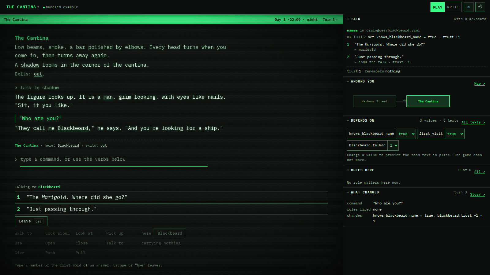

# Writing stories

This guide tells you how to write a story for loremaster. The examples are in `examples/lighthouse` and `examples/cantina`.

## Project folder

A story is a folder of YAML files. Each entity has its own file.

| Path | Contents |
| --- | --- |
| `story.yaml` | Title, start room, intro, clock, variables, custom verbs, the score and story frames. |
| `rooms/*.yaml` | One room in each file. A room file can also have rules. |
| `things/*.yaml` | One thing or character in each file. A thing file can also have rules. |
| `rules/*.yaml` | One rule, or a list of rules, in each file. Read [Rules](#rules). |
| `timers/*.yaml` | One timer in each file. Read [Timers](#timers). |
| `machines/*.yaml` | One puzzle machine in each file. Read [Puzzle machines](#puzzle-machines). |
| `verbs/*.yaml` | One custom verb in each file, as an item of `verbs:` in story.yaml. |
| `behaviors/*.yaml` | One file for each behavior in Rust, with notes about it. Read [Behaviors in Rust](#behaviors-in-rust). |
| `tests/*.yaml` | One walkthrough test in each file. Read [Walkthrough tests](#walkthrough-tests). |
| `threads/*.yaml` | One long-range thread in each file. Read [Author notes and threads](#author-notes-and-threads). |
| `dialogues/*.yaml` | One talk with a thing in each file. Read [Dialogues](#dialogues). |

The id of an entity is its file name. You can set `id:` to use a different id.

To examine a story for problems, run `task check:story` or `cargo run -p loremaster --no-default-features -- check <folder>`.

## Start a new story

A new story has two files: `story.yaml` and the start room `rooms/start.yaml`. The start room has a placeholder text. Replace it with your text.

- In the terminal: `cargo run -p loremaster --no-default-features -- new <folder> --title "The Drowned Bell"`. The folder must not contain a `story.yaml`.
- In the editor: open the project menu or the command palette (Ctrl+K), then select "New story…". Type the title and push Enter. The browser keeps the story as a working copy. "Open my story …" in the same menu opens it again.
- With AI: type an idea too. The AI writes the first 2 or 3 rooms as a proposal. Read "Start a new story with AI" in `docs/ai-tools.md`.

## Fragments

A text is a list of fragments. A fragment is a plain string, or a map with these fields:

| Field | Meaning |
| --- | --- |
| `text` | The text, with inline markup. |
| `variants` | More texts for the modes `cycle`, `shuffle` and `sticky`. |
| `when` | A condition. The fragment shows only when the condition is true. |
| `mode` | `always`, `first_visit`, `once`, `cycle`, `shuffle` or `sticky`. |
| `layer` | `base`, `ambient`, `event`, `objects`, `characters` or `exits`. |
| `replaces` | `true` hides the fragments before it in the same layer. |

## Inline markup

| Markup | Result |
| --- | --- |
| `{night: moonlit \| sunlit}` | "moonlit" at night, else "sunlit". |
| `{first: , new to you,}` | The text only on the first visit. |
| `{lamp.lit ? glowing : dark}` | Any condition, with two texts. |
| `{weather}` | The value of a variable. |
| `{lamp.name}`, `{lamp.the}`, `{lamp.The}`, `{lamp.a}`, `{lamp.A}` | The current name of a thing, with an article. A proper name gets no article. |

## Conditions

Conditions use variables, thing properties and values that the runtime calculates:

- Variables and properties: `flooded`, `lamp.lit`, `sanity >= 3`, `weather == fog`.
- Time: `night`, `time.phase == dusk`, `time.hour`, `time.day`, `turns`.
- Place: `here == cellar`, `in(cellar)`, `cellar.visits`, `visited(cellar)`, `first_visit`, `level`.
- Things: `carried(lamp)`, `present(lamp)`, `lamp.location`, `lamp.interactions`, `lamp.talked`.
- Containers: `in(coin, trophy_case)` is true when the coin is in or on the trophy case, also deeper inside.
- Timers: `timer.fuse` is the number of turns left, 0 when the timer does not run. `timer.fuse.running` is true while it runs.
- Machines: `exorcism == lit`. The id of a machine is a variable with its state.
- Chance: `chance(30)` is true in about 30 of 100 turns. In one state, the result is always the same, so a game replays.
- The current action: `action.repeat`, `action.count`, `action.total`, `action.verb`.

Use `and`, `or`, `not` and parentheses to join conditions.

## Action frames

An action frame adds author text around the response to a verb. Frames are optional. A story without frames plays as before.

```yaml
# story.yaml, a room file or a thing file
frames:
  look:
    before:
      - when: action.repeat == 1
        text: "You look around."
      - when: action.repeat == 2
        text: "You look around, again."
      - when: action.repeat >= 3
        text: "You keep looking around, and nothing seems to change."
```

A frame has three parts. All parts are lists of fragments:

- `before` shows before the response.
- `instead` replaces the default response when one of its fragments applies. Rules still fire.
- `after` shows after the response.

The runtime uses the most specific frame for the verb: the frame on the first thing of the command, then the frame on the current room, then the frame on the story.

The counters include the current action:

- `action.repeat` is the number of times in a row that the player gave the same command.
- `action.count` is the number of times that the player used the verb in this room.
- `action.total` is the number of times that the player used the verb in the game.

The room description that shows when the player enters a room is not an action. Frames do not apply to it.

## Name stages

A thing or a character can have names that change with the state. The last stage whose condition is true is the current name.

```yaml
# things/blackbeard.yaml
name: shadow
names:
  - { text: shadow, aliases: [figure, shape] }
  - { when: blackbeard.talked > 0, text: grim-looking man, aliases: [man] }
  - { when: knows_blackbeard_name, text: Blackbeard, aliases: [captain], proper: true }
```

- The text, the verb bar, the room brief and the default responses use the current name.
- The parser accepts the names of the current stage and of all stages before it. It does not accept a name that the player has not learned yet.
- Set `proper: true` for a proper name. A proper name gets no article.
- The author tooltip shows all stages and the current stage.

## Dialogues

A dialogue is a talk with a thing, for example a character. Put it in `dialogues/<id>.yaml`. The player starts it with "Talk to" and the thing.

```yaml
# story.yaml: the relations that dialogues can change
relations: [trust]
```

```yaml
# dialogues/blackbeard.yaml
with: blackbeard
start: [again, meet]
nodes:
  meet:
    say: 'The figure looks up. "Sit, if you like."'
    options:
      - say: '"Who are you?"'
        go: names
      - say: '"Not tonight."'
        go: end
  names:
    say: '"They call me Blackbeard."'
    set: { knows_blackbeard_name: true }
    relation: { trust: 1 }
    options:
      - say: '"Where did the *Marigold* go?"'
        when: blackbeard.trust >= 1
        remember: [asked_marigold]
        go: back
  again:
    when: blackbeard.talked > 1
    say: '"Back again."'
    options:
      - { say: '"Goodbye."', go: end }
```

- `with` is the id of the thing.
- `start` is a list of node keys. The talk starts at the first node whose `when` holds.
- A node is one line of the thing (`say`). Its `options` are the answers of the player.
- An option has a `say` (the line of the player, and the text of the choice), an optional `when`, and `go`. `go` is a node key, `end` or `back` (the node before). Without `go`, the option ends the talk.
- A node or an option can change the state when it applies:
  - `set` and `add`: as in a rule.
  - `relation`: add to the relation of the player to the thing, for example `{ trust: 1 }`. Declare each relation in `relations` in `story.yaml`.
  - `remember`: memories that the thing keeps.
  - `then`: world effects, as in a rule: `move`, `goto`, `say`, `end`.
- `say` uses inline markup.

Conditions can read the new values:

- `blackbeard.trust` is the relation of the player to the thing. It starts at 0.
- `remembers(blackbeard, asked_marigold)` is true when the thing keeps the memory.

During a talk:

- The story text shows only what is said: the answer of the player, then the line of the thing.
- In the web player, the answers are in the verb bar, as numbered buttons. Click an answer or push its number key. When the talk starts, the focus goes to the first answer.
- In the terminal, the answers show as a numbered list after the text. Type a number, or the first word of an answer.
- Each answer takes one turn.
- Other commands do not run. To leave the talk, type `bye` or `leave`, or push Escape.
- A talk ends when the player chooses an answer that ends it, when a node has no answer that shows, or when an effect takes the player away.

`loremaster check` examines each dialogue: conditions, markup, targets of `go`, and nodes that no start node leads to.



In the editor, the room desk shows the dialogues of the things in the room. During a talk in write mode (Ctrl+E), you can change the line and the answers in the game text.

## Exits

An exit is a way from one room to a different room. Write the exits of a room in its file, one on each line:

```yaml
# rooms/shore.yaml
exits:
  - { direction: north, to: cottage, door: cottage_door }
  - { direction: east, to: stairwell, door: lighthouse_door }
  - { direction: west, blocked: "Cold surf breaks over the rocks. There is only the sea that way." }
```

| Field | Contents |
| --- | --- |
| `direction` | `north`, `northeast`, `east`, `southeast`, `south`, `southwest`, `west`, `northwest`, `up`, `down`, `in`, `out`, or a name. |
| `to` | The room that the exit goes to. |
| `door` | A thing that must be open. The player opens a closed door first. A locked door stops the player. |
| `visible` | A condition. When it is false, the exit is hidden and the player cannot use it. |
| `passable` | A condition. When it is false, the player cannot go through, and the game shows `blocked`. |
| `blocked` | Markup. The game shows it when the player cannot go through. |
| `traversal` | Markup. The game shows it when the player goes through. |

The player can type `back`, `go back` or `return` to go back to the room before. The game looks for a visible exit of the current room that leads to that room, and uses it with its door, `passable` and `traversal`. You do not have to write anything for this. When no exit leads back, for example after a one-way drop, the game says "You can't go back the way you came." An exit with the direction `back` replaces this.

### Message exits

An exit without `to` is a message exit. It goes to no room. When the player goes in its direction, the game shows `blocked`, and the player stays in the room. The move uses a turn, as a move that fails.

- A message exit must have `blocked`. The check gives an error for an exit without `to` and without `blocked`.
- `blocked` is markup, as in all exits. It can have conditions, for example `"{night: The surf is black. | Cold surf breaks over the rocks.}"`.
- `visible` works as in other exits. When it is false, the player gets the default response.
- A message exit does not use `door`, `passable` or `traversal`. The check gives a warning for them.
- The scene, the verb bar and the room brief do not show message exits, because they go to no room. The map shows a message exit as a short line out of the room that ends in a bar.
- In write mode, a new exit in the direction of a message exit replaces the message exit.

## Rules

A rule fires on an event. If its condition `when` is true, its effects `then` run.

```yaml
# rules/drawer.yaml
- id: find_iron_key
  on: { verb: [open, drawer] }
  when: not drawer_searched
  then:
    - set: { drawer_searched: true }
    - move: { iron_key: cottage }
    - say: "Under a fold of oilcloth lies an iron key."
```

The events:

| Event | When it fires |
| --- | --- |
| `start` | The game starts. |
| `turn` | Each turn, after the command. |
| `{ enter: room }`, `{ leave: room }` | The player enters or leaves the room. |
| `{ time: "21:00" }` | The clock reaches the time. |
| `{ check: [verb, thing] }` | Before the verb. Read [Action phases](#action-phases). `{ check: [go, north] }` checks a move. |
| `{ verb: [verb, thing, other] }` | After the default response of the verb, or instead of it with `instead: true`. Fewer parts match more commands. |
| `{ timer: fuse }` | The timer runs out. |
| `{ event: blast }` | An `emit: blast` effect sends the event. |
| `{ talk: [dialogue, node] }` | A dialogue reaches the node. `[dialogue]` matches all nodes. |

The effects:

| Effect | What it does |
| --- | --- |
| `set: { name: value }` | Sets variables and properties. |
| `add: { name: 1 }` | Adds to number variables. |
| `say: "text"` | Shows the text. Inline markup is permitted. |
| `move: { thing: place }` | Moves things. The place is a room, `carried`, `nowhere`, `in:box` or `on:table`. |
| `goto: room` | Moves the player. Leave and enter rules fire. |
| `end: "text"` | Ends the game with the text. |
| `stop` | Stops the action. Read [Action phases](#action-phases). |
| `emit: name` | Sends a custom event. Rules `on: { event: name }` fire immediately. |
| `start: fuse` or `start: { fuse: 6 }` | Starts a timer, with its own turns or with a number of turns. |
| `cancel: fuse` | Stops a timer. Its rules do not fire. |

More fields: `once: true` lets the rule fire only one time in a game. `instead: true` makes a verb rule replace the default response.

### Action phases

A verb goes through these phases:

1. `check` rules. A check rule with `stop` refuses the action. Then no other phase runs, but the turn passes.
2. `instead` rules (verb rules with `instead: true`). If one fires, it replaces the default response.
3. The default response of the verb, or an `instead` frame.
4. The other verb rules. They can read the result of the default response, for example `lamp.lit`.
5. The `after` frame, then turn rules, timers and time rules.

```yaml
- id: dead_lamp
  on: { check: [turn_on, lamp] }
  when: not timer.lamp_battery.running
  then:
    - say: "A burned-out lamp won't light."
    - stop
```

`stop` in an `instead` or a verb rule stops the rules after it in that phase, and the later phases.

### Scope and priority

Put a rule in a thing file or a room file, under `rules:`. Or give a rule `within: <thing, room or region>`.

- A thing rule fires for verbs on that thing. For other events, it fires while the thing is present.
- A room or region rule fires while the player is in the room or region.

In one phase, thing rules run first, then room rules, then region rules, then story rules. In one scope, a higher `priority` runs first. Rules with the same priority run in file order.

```yaml
# things/rug.yaml
rules:
  - id: rug_too_heavy
    on: { verb: [take] }
    instead: true
    then:
      - say: "The rug is extremely heavy and cannot be carried."
```

## Timers

A timer counts down by one each turn. Put it in `timers/*.yaml`, or in a `timers:` list in story.yaml.

```yaml
# timers/lamp_battery.yaml
turns: 385
running: true
runs_while: lamp.lit
at:
  15: [{ say: "The lamp is nearly out." }]
  0: [{ set: { lamp.lit: false } }]
```

| Field | Meaning |
| --- | --- |
| `turns` | The turns from the start value to zero. |
| `running` | `true`: the timer runs from the start of the game. Else, a `start` effect starts it. |
| `runs_while` | The timer counts down only while this condition is true. |
| `at` | Effects at a number of turns left. At 0 the timer runs out. Then rules `on: { timer: id }` fire. |
| `repeat` | `true`: the timer starts again when it runs out. |

The turns left are part of the save game. In the Atlas, "State" shows them as `timer.<id>`, and you can set them.

## Containers and scenery

A thing with `container: true` can hold things. A thing with `supporter: true` can have things on it. Put a thing in or on another one with `location: { in: box }` or `location: { on: table }`.

```yaml
# things/trophy_case.yaml
name: trophy case
location: { room: living_room }
container: true
capacity: 20
listed: false
props: { open: false, transparent: true }
```

- The player uses `put coin in case` or `put coin on table`.
- A container with an `open` property holds its contents only while it is open. While it is closed, the player can not see or take them. With `transparent: true`, the player can see them, but not take them.
- `capacity` is the number of things that fit. Without it, any number fits.
- The room text, `examine`, `open` and the inventory tell the contents.
- The contents move with their container. A carried bag carries what is in it.

Scenery can be in more than one room. `also_in: [forest_1, forest_2]` or `also_in: [forest]` (a region) puts the thing in these rooms too, while its location is not `nowhere`.

## Score

```yaml
# story.yaml
score:
  max: 350
  ranks:
    - { from: 0, name: Beginner }
    - { from: 26, name: Amateur Adventurer }
```

With a score, the command `score` shows the score, the moves and the rank. The score is the number variable `score`. Set `var:` for a different variable. If story.yaml does not declare the variable, the loader declares it. Rules change the score with `add: { score: 10 }`.

## Puzzle machines

A machine is a puzzle with named states and steps between them. Use a machine for a puzzle with an order, such as a ritual or a dam.

```yaml
# machines/exorcism.yaml
start: idle
states: [idle, rung, lit, done]
steps:
  - from: idle
    on: { verb: [ring, bell] }
    to: rung
    instead: true
    say: "The bell suddenly becomes red hot."
    then: [{ start: exorcism_window }]
  - from: rung
    on: { verb: [turn_on, candles] }
    when: candles.carried
    to: lit
  - from: [rung, lit]
    on: { timer: exorcism_window }
    to: idle
```

- A step fires on its event when the machine is in one of its `from` states and `when` is true. Then the machine goes to `to`, shows `say` and runs `then`.
- A machine takes one step for one event only.
- The id of the machine is a variable with its state. Conditions read it: `exorcism == lit`.
- Each step is a rule with the id `<machine>#<number>`. The rules view, the checks and the explorer show them.
- Without `states`, the states are the start state and all states that the steps name.
- A state in the list can be a map with a description for the authors: `{ name: rung, description: The spirits are stunned. }`. The player does not see it.

In the editor, Atlas › Machines shows each machine: the states in a row, and the steps as numbered arrows. Forward steps are above, steps back are below. The current state is filled. A step that the next event can take is marked. Point at a state or a step to light its connections. Select a state to see its description and its steps in and out on the right. There you can also change the description, rename the state, or delete a state that no step uses. "+ State" under the drawing adds a state. A rename changes the start and the steps of the machine, but not conditions in other files, such as `exorcism == lit`. The checks show these.

The checker finds unknown states and states that no step goes to.

## Behaviors in Rust

Some logic is too large for rules, for example a character that walks the map and steals. A game that uses loremaster as a library can write this logic in Rust as a behavior.

1. Write a type that implements `loremaster_runtime::Behavior`. Its `handle` method gets each event, after the rules of the event.
2. Change the world only through `Cx`: facts, things, the player, text, events and `roll`. Then the save game, the walkthroughs and the explorer see all changes. Do not keep state in fields of the type.
3. Register the behavior: `world.register(Thief::zork())`.
4. Name the behavior in the story: `behaviors: [thief]` in story.yaml, or a file `behaviors/thief.yaml` with notes.

A build without the code, such as the editor or `loremaster play`, plays the story without the behavior. The rules view shows the behavior as code, and the terminal commands show a note.

`Flow::Stop` from `handle` works as the `stop` effect. The example is the thief of Zork I: `examples/zork1/thief.rs`. Run `cargo run -p loremaster-runtime --example zork` to play Zork I with it.

## Author notes and threads

Notes are text for the authors. The player does not see them. Put the notes in the file of the entity that they are about, in a `notes:` list. You can add notes to `story.yaml`, to rooms, things and rules, and to a fragment in its map form.

```yaml
# rooms/shore.yaml
name: The Shore
notes:
  - Hal's boat must feel abandoned, not wrecked.
  - todo: Decide if the ferryman comes back at dawn.
  - { todo: Name the gull., done: true }
description:
  - id: gull
    text: "A gull watches you from the boat."
    notes:
      - { text: First hint at the key., thread: lost_key, role: setup }
```

| Form | Meaning |
| --- | --- |
| A string | A note. |
| `todo: …` | A TODO. Add `done: true` when it is done. |
| `text: …` | A note with more fields: `id`, `thread` and `role`. |

A thread is a promise to the reader that goes across the story, for example a hint early in the story that resolves at the end. Each thread has a file in `threads/`:

```yaml
# threads/lost_key.yaml
name: The lost key
status: open          # open, resolved or dropped
summary: Hal hid the key of the lamp room before he went away. The gull knows.
tracks: [knows_key]   # optional: the variables or properties that carry the thread
notes:
  - todo: Add a second hint on the cliff path.
```

The beats of a thread are the notes that have `thread: <id>`. `role` tells what the beat does:

| `role` | Meaning |
| --- | --- |
| `setup` | The reader learns or sees something that is important later. |
| `payoff` | The thread resolves here. |
| `mention` | The thread shows again, so that the reader remembers it. |

The checker tells you about these problems:

- A note names a thread that does not exist. This is an error.
- An open thread has a setup and no payoff. This is a warning.
- A thread has a payoff and no setup. This is a warning.
- A resolved thread has open TODOs. This is a warning.

A dropped thread gives no warnings. Use it to keep an idea that you removed.

The state explorer (`loremaster explore`, or Atlas › Checks in the editor) plays all the ways through the story and follows the beats. For each open or resolved thread with a payoff, it tells you:

- No explored path shows the payoff. Then the player can never see it.
- The payoff shows before any setup. The explorer gives the shortest path, and the editor can replay it.

A beat on a fragment shows when that fragment shows. A beat on a room or a thing shows when any of its text shows. A beat on a rule shows when the rule fires. A `mention` is not checked.

To list all open TODOs with their file and line, run `cargo run -p loremaster --no-default-features -- check <folder> --todos`.

In the editor:

- In write mode, the room desk has a "Notes and threads" section. It shows the notes and TODOs of the room and of the things in it. Type a text, then select "+ Note" or "+ TODO". Select the checkbox of a TODO when it is done. "×" removes a note.
- Above the notes, chips show the thread beats in this room, for example "setup · The Marigold". "no payoff yet" is a warning: an open thread has a setup here and no payoff. Select a chip to open Atlas › Threads.
- The status line shows the number of open TODOs. Select it to open Atlas › TODOs, with all open TODOs of the story. Select the place of a TODO to go to its room. Ctrl+K, "Add a TODO, or find the done ones", opens the same tab.
- In Atlas › TODOs, "Show" selects the open TODOs, the done TODOs or all. A done TODO stays in its file, struck through; clear its checkbox to open it again. "×" removes a TODO from the file. Then it is gone.
- A TODO that you add in Atlas › TODOs goes into `story.yaml`, for the whole story.
- In write mode, the margin note of a fragment shows its notes ("✎ 1 note") and its threads, for example "setup of lost_key".
- The fragment panel has "Notes and threads of this fragment": the notes of the fragment, and a form to tie it to a thread as a setup, a mention or a payoff.
- Atlas › Threads shows each thread with its beats, its status and its warnings. Change the status with its select. "+ Thread" makes a new file in `threads/`. "Explore" runs the state explorer for the payoff checks.

If a note contains a colon, put it in quotes, for example `- "Premise: a lighthouse without a keeper."`. Without quotes, YAML reads the colon as a map. loremaster then keeps the text, but other tools can read it differently.

## The Atlas

The Atlas shows the whole world at full width. Push Ctrl+M, or select the room name in the status line. Push Escape, or select "Back to …", to go back to the game at the same turn.

| View | What it shows |
| --- | --- |
| Map | The floors on the left. The map of a floor in the middle: drag or use the arrow keys to move, the wheel or + and − to zoom, F to see the whole floor. "/" finds a room or a thing. "List view" shows the rooms as a table. The room card on the right has "Go there", "Write here" and "Explore". |
| Rules | All rules, with "Here and now", "Fired" and "All". |
| Machines | The puzzle machines, with their states and steps. The tab shows only when the story has machines. |
| State | All variables and properties, with their values now. A switch sets a value in the game. |
| Story | The turns so far. |
| Checks | The texts of the current room in all states, and the whole-game explorer. |

## Levels

A room can be on a level, for towers and dungeons. Up exits go one level higher, down exits one level lower.

```yaml
# rooms/north_2.yaml
name: "North Landing, Second Floor"
level: 2
position: [1, 0]
```

- A room without `level` gets its level from the `up` and `down` exits, counted from the start room (level 0).
- `position` is the place of the room on its level. Rooms on different levels can have the same position.
- The condition `level` is the level of the current room, for example `level == 3`.

With more than one level, the map has two views:

- **One level**: the level of the player in full. The levels above and below show faint behind it. ▲ and ▼ mark rooms with stairs. "Up" and "Down" show another level.
- **All levels, unfolded**: one row for each level, the highest at the top, the rooms of each level in ring order (north first, then clockwise). Each row moves sideways so that the top of a stair is right above its foot, and the stair is a straight line. A spiral reads as a staircase, so a stair to the wrong room is easy to see. A wide drawing scrolls sideways, and it starts at the current room.

The example `examples/tower` ("The Spiral") is a tower with three floors of four landings each. The stair on each west landing goes up to the north landing of the next floor.

## Examine one room in all conditions

The room matrix shows the text of one room in each combination of the values that the text depends on. It also shows combinations that the player can not reach. Use it to find a text that reads badly in one condition.

1. In the web app, go to the room.
2. In the side panel, the section "Depends on" shows the values that the room text depends on. Change a value to preview the room text in place; the game does not move. "Make it so" sets the values in the game. "All texts ↗" opens Atlas › Checks with all the texts. "This room" is its default mode.

The runtime finds the values in these locations:

- The conditions of the room fragments.
- The inline markup of the room fragments.
- The presence texts and the name stages of the things in the room.

For a number, the runtime tries the values next to each limit in a condition. For example, `talked > 0` gives 0 and 1. The matrix renders not more than 256 combinations.

The view shows each different text one time, with the combinations that give it. It marks these possible problems:

- No room text.
- Two spaces in a row, a space before punctuation, or a brace in the text.
- Two replacing fragments of one layer that apply at the same time.
- Two or more presence texts of one thing that show at the same time.

After a "Whole game" run, each text has a mark: "seen in the whole-game run" or "not seen in the whole-game run". A text that the run did not see can be unreachable, or it can be outside the budget of the run.

"Try this" puts the game into one combination. It moves the player to the room and sets each value. It does not play a turn.

## Examine all states

The state explorer plays all ways through the story from the start. It stops at 2000 states or 40 commands.

1. In the web app, open Atlas › Checks (Ctrl+M, then "Checks"), select "Whole game", then select "Explore all states".
2. Or, run `task explore` or `cargo run -p loremaster --no-default-features -- explore <folder>` in a terminal.

The explorer shows:

- Each way the text of a room reads, with the shortest command list to it.
- Fragments that never show and rules that never fire.
- Endings, with the shortest command list to each.
- Stuck states: states from which the player can not reach an ending.

The explorer tries the actions that move the story forward: exits, verbs that rules listen to, take, open, turn on, unlock with a key in reach, and wait when the story reacts to time. It does not try drop, close, turn off or lock.

In the web app, "Replay this path" starts the game again and plays the command list. You can then continue from that state.

## Walkthrough tests

A walkthrough is a test that plays the story. Put it in `tests/*.yaml`.

```yaml
# tests/win.yaml
name: Light the beacon
steps:
  - n
  - { do: open drawer, see: "Under a fold of oilcloth lies an iron key." }
  - take key
expect:
  facts: { beacon_lit: true }
  room: lantern_room
  ended: true
```

- A step is a command. A step in the map form can also say what its response must show: `see` and `not_see`, with one text or a list. It can also have `facts`, `room` and `ended`.
- `expect` says what must be true after the last step. `see` there looks at the whole transcript.

Run `cargo run -p loremaster --no-default-features -- test <folder>`, or `task walkthroughs` for all examples. The command names each step that failed. The Rust tests run the walkthroughs of all examples, so CI runs them too.

## Write in the game

You can change the story while you play it. The game keeps its state after each change.

1. Select "Write" in the header, or push Ctrl+E (Cmd+E on a Mac). The shortcut also works while you type.
2. In the newest room text, select a fragment. It opens for editing in place, and it still reads as the player reads it.
3. Type in the game text. Markup shows as a chip with the text that it gives now; select a chip to see and change its markup.
4. The fragment panel has the properties: the mode ("Shows"), the condition ("When"), the layer and the variants. "Reads in other states" shows how the text reads in other values. "</> Show markup" (Ctrl+/) shows the text with all its markup; you can type in both places. On a screen from 900px wide, the panel is next to the game text, with the room pinned on top: change a value there to see the fragment in the game text in that value. On a narrow screen, the panel is under the paragraph.
5. Push Enter to save. Push Shift+Enter for a line break. Push Escape to cancel.

### Type first, tune later

Select words in the game text or in the writer. A small toolbar shows (or push Ctrl+.):

| Action | Result |
| --- | --- |
| Use the name | The selected name of a thing, for example "the oil lamp", becomes `{oil_lamp.the}`. Then the name changes with the thing. |
| Make it a thing | The selected words become a new thing in the room. The text does not change. |
| Only the first time | `{first: …}` goes around the selection. |
| Only when… | `{ ? …}` goes around the selection. Write the condition before the `?`. |
| Make variants | Write alternatives with " / " between them, for example `The wind howls / drops.`, and select them. Each alternative becomes a variant of the fragment. |

More actions in write mode:

- "+ Add room text" adds a fragment to the current room.
- In write mode, each fragment of the room text is on its own line, with a note in the margin: its layer, its mode and its condition. "+ N hidden here" shows the fragments that do not show now, struck through, with the reason in the margin. Select one to edit it.
- "Remove this fragment" removes the fragment from the file.

Help while you type:

- Completion: in markup (inside `{…}`) and in the condition, the editor suggests names with their values now. After `==` it suggests the values, for example the phases of the day. Push Ctrl+Space to open the list.
- Hover: put the pointer on a name to see what it is and its value now.
- Quick fix: for an unknown name, "Use …" puts in the name that the editor finds, for example `oil_lamp.lit` for `lamp.lit`.
- "Other values" shows how the text reads in each combination of the values that it depends on, and in which combinations it does not show.

The editor examines the text while you type. A problem has a wavy line and a message, and you cannot save until you correct it. When a change does not build, the writer stays open with the message, and the game keeps the last good version.

### Make new rooms, things and responses

In write mode, the game helps you make what is not there yet:

| You do | The game shows | It makes |
| --- | --- | --- |
| Walk in a direction that has no exit, for example `s`. | A form for a new exit. | The exit, a new room or a link to an existing room, and the way back. You walk into the new room, and the writer opens for its text. For "nowhere, only a message", write the text that a move in that direction shows: the editor makes a message exit, and you try it at once. |
| Write a name that the story does not know, for example `{brass_key.The}`. | "Create thing brass_key" under the problem. | A thing in the current room. The writer stays open. |
| Give a command that gets the default response, for example `push brass key`. | "+ Write a response for “push brass key”". | A rule in `rules/<room>.yaml` that answers the command with your text. |
| Ctrl+K, "Create a thing", "Create a character" or "Create an exit". | The same form. | A thing or a character in the current room (the writer then opens for its presence text), or an exit. |

The editor makes the ids from the names. For example, "The Beach" becomes `the_beach`.

### AI proposals

When `loremaster serve` runs for the story (read `docs/ai-tools.md`), the editor reads the open proposals of the AI assistant from it:

- The status line shows "✦ N proposals", or "✦ drafting… 12 s" while a job runs. Select it to open the AI tray. The tray shows the jobs, their cost and the warning about the files. "All jobs and proposals ↗" opens Atlas › AI, with the jobs and with each proposal, its changes and its problems.
- In write mode, a proposal that changes the text of the current room shows as ghost text (italics, a dotted line and ✦) under the fragment that it changes, with its card in the margin.
- A proposal that adds or removes rooms or exits shows on the maps: on the Atlas map, on the small map of the side panel and in the list view. What it adds is dashed in the ghost colour, and a new room has ✦ before its name. What it removes is in the warning colour, and a removed room is struck through. Select a proposed room on the Atlas map: its room card has "Walk in", "Accept" and "Reject".
- "Walk in" plays the story with the proposal in a sandbox, from the game state now (or from the proposed room). The status line shows "SANDBOX" with "Accept" and "Leave". Press Escape to leave. The editor does not save the sandbox, and write mode and AI jobs are off in it.
- "Accept" writes the proposal into the working copy of the editor, then tells the server. A proposal can also delete files; the editor then deletes them from the working copy and from the linked folder. The editor refuses a proposal when a file that it changes is different now. "Reject…" asks why (optional) and tells the server to drop it. The AI reads the note and does not offer the idea again.
- Keys: when the focus is in a proposal card, A accepts, R rejects and W walks in. Alt+P moves the focus to the next proposal card.

In write mode, the room desk has an "✦ AI here" section while the server runs:

- "Review this room" asks the AI to read the room in all its states and to propose fixes. While the review runs, the button shows the time. Each finding is a note in the margin, next to its fragment, with its severity (HIGH, MEDIUM or LOW), the problem and the fix. A finding about the whole room, or about a fragment that does not show now, is under the room text. Select × to dismiss a finding.
- The section shows the number of findings and the number of open proposals for this room.
- In write mode, a direction without an exit offers "✦ Draft … with AI" next to the form: the AI proposes some exits or things for that direction.
- The AI tray of the status line shows all jobs with their time, their proposals and their cost. You can cancel a running job there.
- The server reads the story folder on disk, and the editor keeps a working copy in the browser. When the two differ, the AI tray and the header warn you, and the chip shows ▲. Open the story folder (Chromium browsers), so that both use the same files.

### Where the changes go

A change goes into the story file. Only the changed lines in the file change, so comments and formatting stay.

- The browser keeps a working copy of each story (in the Origin Private File System). The header shows "edited, saved in browser".
- In Chrome, Edge and other Chromium browsers, use the command palette (Ctrl+K), "Open a story folder on disk". Then each change goes to the folder too. After a reload of the page, the browser asks for access to the folder again: use "Give access to the folder again" in the command palette.
- In all browsers, "Export the story as a zip file" and "Import a story from a zip file" move a story in and out.
- "Go back to the bundled example" removes the working copy.
